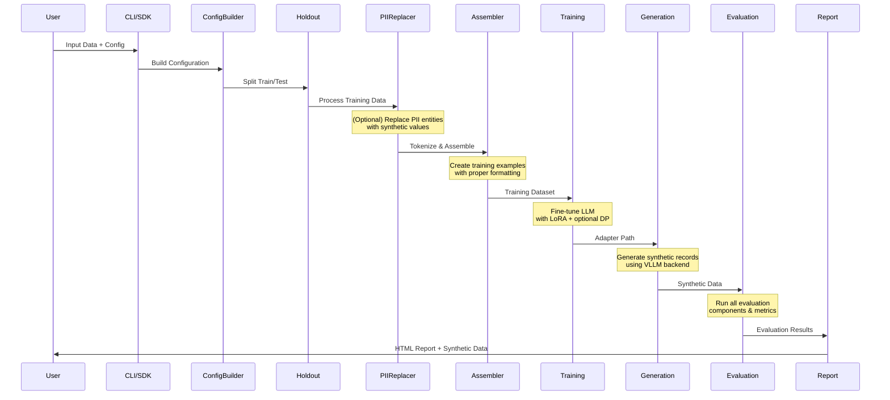
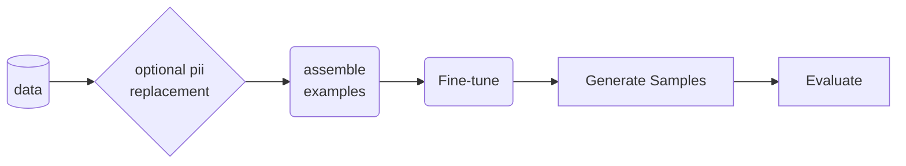

# NeMo Safe Synthesizer - Architecture Diagram

## Overview
NeMo Safe Synthesizer is a comprehensive package for generating safe synthetic data with privacy guarantees. The architecture follows a pipeline design with configurable stages for data processing, PII replacement, training, generation, and evaluation.

---

## High-Level Architecture

```mermaid
graph TB
    subgraph "Entry Points"
        CLI[CLI Interface<br/>main.py]
        SDK[SDK Interface<br/>SafeSynthesizer]
    end

    subgraph "Configuration Layer"
        ConfigBuilder[ConfigBuilder]
        SafeSynthesizerParams[SafeSynthesizerParameters]
        
        subgraph "Config Components"
            DataConfig[DataParameters]
            TrainConfig[TrainingHyperparams]
            GenConfig[GenerateParameters]
            EvalConfig[EvaluationParameters]
            PIIConfig[ReplacePiiConfig]
            DPConfig[DifferentialPrivacyHyperparams]
        end
    end

    subgraph "Data Processing Pipeline"
        DataSource[Input Data<br/>DataFrame/CSV]
        Holdout[Holdout<br/>Train/Test Split]
        PIIReplacer[PII Replacement]
        DataActions[ActionExecutor<br/>Data Transformations]
        Assembler[ExampleAssembler<br/>Tokenization]
    end

    subgraph "Training Backend"
        TrainingBackend[TrainingBackend<br/>Abstract]
        HFBackend[HuggingFaceBackend<br/>LoRA + DP Support]
        
        subgraph "Training Components"
            ModelLoader[Model Loader<br/>AutoModel + Tokenizer]
            Quantization[Quantization<br/>4-bit/8-bit]
            LoRA[LoRA Config<br/>PEFT]
            DPTrainer[Differential Privacy<br/>OpacusDPTrainer]
            Callbacks[Training Callbacks]
        end
    end

    subgraph "Generation Backend"
        GenBackend[GeneratorBackend<br/>Abstract]
        VLLMBackend[VllmBackend<br/>Fast Inference]
        
        subgraph "Generation Components"
            RegexManager[RegexManager<br/>Structured Output]
            BatchGen[BatchGenerator]
            Processors[Processors<br/>Output Processing]
            Stopping[Stopping Criteria]
        end
    end

    subgraph "Evaluation System"
        Evaluator[Evaluator]
        
        subgraph "Evaluation Components"
            DataPrivacy[Data Privacy Score]
            PIIReplay[PII Replay Detection]
            MembershipInf[Membership Inference<br/>Protection]
            AttributeInf[Attribute Inference<br/>Protection]
            Distribution[Column Distributions]
            Correlation[Correlations]
            TextSimilarity[Text Semantic<br/>Similarity]
            StructureSimilarity[Text Structure<br/>Similarity]
            SQS[SQS Score]
        end
        
        subgraph "Reporting"
            ReportGen[Report Generator]
            HTMLReport[HTML Report<br/>Multi-modal]
        end
    end

    subgraph "Supporting Modules"
        Artifacts[Artifacts System<br/>Analyzers & Metadata]
        LLMUtils[LLM Utilities<br/>Model Management]
        Privacy[Privacy Module<br/>DP Transformers]
        Records[Records System<br/>JSON/Fragment]
        Stats[Statistics]
        Observability[Observability<br/>CategoryLogger + Tracing]
        Configurator[Configurator<br/>Pydantic→Click]
    end

    CLI --> ConfigBuilder
    SDK --> ConfigBuilder
    ConfigBuilder --> SafeSynthesizerParams
    SafeSynthesizerParams --> DataConfig
    SafeSynthesizerParams --> TrainConfig
    SafeSynthesizerParams --> GenConfig
    SafeSynthesizerParams --> EvalConfig
    SafeSynthesizerParams --> PIIConfig
    SafeSynthesizerParams --> DPConfig

    DataSource --> Holdout
    Holdout --> PIIReplacer
    PIIReplacer --> DataActions
    DataActions --> Assembler
    Assembler --> TrainingBackend

    TrainingBackend --> HFBackend
    HFBackend --> ModelLoader
    HFBackend --> Quantization
    HFBackend --> LoRA
    HFBackend --> DPTrainer
    HFBackend --> Callbacks

    HFBackend --> GenBackend
    GenBackend --> VLLMBackend
    VLLMBackend --> RegexManager
    VLLMBackend --> BatchGen
    VLLMBackend --> Processors
    VLLMBackend --> Stopping

    VLLMBackend --> Evaluator
    Evaluator --> DataPrivacy
    Evaluator --> PIIReplay
    Evaluator --> MembershipInf
    Evaluator --> AttributeInf
    Evaluator --> Distribution
    Evaluator --> Correlation
    Evaluator --> TextSimilarity
    Evaluator --> StructureSimilarity
    Evaluator --> SQS

    Evaluator --> ReportGen
    ReportGen --> HTMLReport

    TrainingBackend -.-> LLMUtils
    GenBackend -.-> LLMUtils
    TrainingBackend -.-> Privacy
    DataActions -.-> Records
    Evaluator -.-> Stats
    DataActions -.-> Artifacts
    TrainingBackend -.-> Observability
    GenBackend -.-> Observability
    Evaluator -.-> Observability
    ConfigBuilder -.-> Configurator
```



---

## Execution Flow




## Simple overview


---

## Component Details

### 1. Configuration Layer

Path: `src/nemo_safe_synthesizer/config/`

- `SafeSynthesizerParameters`: Main configuration class that aggregates all parameters
- `DataParameters`: Dataset and preprocessing configurations
- `TrainingHyperparams`: Training settings (learning rate, epochs, batch size, etc.)
- `GenerateParameters`: Generation settings (temperature, top_p, num_records, etc.)
- `EvaluationParameters`: Evaluation component toggles and settings
- `ReplacePiiConfig`: PII replacement settings and replacement plan (see [PII Replacement Internals](#pii-replacement-internals))
- `DifferentialPrivacyHyperparams`: DP training parameters (epsilon, delta, clipping norm)

### 2. Data Processing Pipeline

Path: `src/nemo_safe_synthesizer/data_processing/`

#### Components:

- Holdout (`holdout/`): Splits data into train/test sets with stratification support
- `pii_replacer/`: PII replacement plan discovery, its OpenAI-compatible LLM client, and `local_inference/`, which runs a vLLM server on the local GPU only while LLM-assisted planning runs
- `ActionExecutor` (`actions/`): Executes data transformations (date normalization, distributions)
- `ExampleAssembler` (`assembler.py`): 
  - Converts records to JSON format
  - Tokenizes for model training
  - Handles truncation and padding

### 3. Training Backend

Path: `src/nemo_safe_synthesizer/training/`

#### Abstract Base:

- `TrainingBackend`: Defines interface for training implementations

#### Implementations:

- `HuggingFaceBackend`: 
  - Supports quantization (4-bit, 8-bit via bitsandbytes)
  - LoRA fine-tuning via PEFT
  - Differential Privacy via Opacus integration
  - Custom callbacks for monitoring
  
#### Key Features:

- Model loading from HuggingFace Hub
- Tokenizer configuration
- Training argument preparation
- Adapter saving (LoRA weights)

### 4. Generation Backend

Path: `src/nemo_safe_synthesizer/generation/`

#### Components:

- `VllmBackend`: 
  - Fast inference using VLLM
  - Loads base model + LoRA adapter
  - Batch generation support
  
- `RegexManager`: 
  - Enforces structured output (JSON format)
  - Validates generated records
  
- Processors: Post-processing of generated text
- `BatchGenerator`: Manages batch generation with retry logic
- Stopping Criteria: Custom stopping conditions for generation

### 5. Evaluation System

Path: `src/nemo_safe_synthesizer/evaluation/`

#### Core:

- Evaluator: Orchestrates all evaluation components

#### Evaluation Components (`components/`):

- Data Privacy Score: Overall privacy assessment
- PII Replay: Detects if original PII values appear in synthetic data
- Membership Inference Protection: Measures resistance to MI attacks
- Attribute Inference Protection: Measures resistance to AI attacks
- Column Distributions: Statistical similarity of distributions
- Correlations: Preservation of column relationships
- Text Semantic Similarity: Semantic similarity (embedding-based)
- Text Structure Similarity: Structural similarity
- SQS Score: Synthetic Quality Score
- Deep Structure: Deep structural analysis

#### Reporting (`reports/`, `render.py`):

- Multi-modal HTML report generation
- Interactive visualizations
- Jinja2 templates for customization
- CSS/JS assets for styling

### 6. Supporting Modules

#### LLM Utilities (`llm/`)

- LLM Definition: Model metadata and configuration
- Model Loading: Utilities for loading models
- Memory Management: VRAM optimization

#### Privacy Module (`privacy/dp_transformers/`)

- `[Opacus](https://opacus.ai/)DPTrainer`: Integration with Opacus for DP-SGD
- Privacy Arguments: DP hyperparameters
- Custom Layers: DP-compatible layers

#### Artifacts (`artifacts/`)

- Analyzers: Data quality checks and field analysis
- Metadata: Dataset metadata management
- Manifest: Artifact tracking

#### Records System (`data_processing/records/`)

- JSONRecord: JSON record representation
- Fragment: Record fragment handling
- `ValuePath`: Path-based value access

---

## PII Replacement Internals

Path: `src/nemo_safe_synthesizer/pii_replacer/`

User-facing behavior is documented in
[docs/product-overview/pii_replacement.md](docs/product-overview/pii_replacement.md)
and [docs/user-guide/customize-pii-replacement.md](docs/user-guide/customize-pii-replacement.md).
This section records how it is implemented.

- `config/replace_pii.py`: `ReplacePiiConfig`, the plan models, and the closed
  entity vocabulary (`ENTITIES`, `ALLOWED_DEPENDS_ON`).
- `planning/`: plan discovery (`llm.py`, `plan_builder.py`, `patterns.py`),
  validation, dependency value mappings, and plan file I/O.
- `replacement/`: the executor, value generators, free-text detection and
  replacement, and the per-entity rules described below.
- `local_inference/`: the managed vLLM server and its bundled profiles.

Plans and sampler mappings are resolved against the full input. Holdout runs
next, and only the training split is replaced, so evaluation keeps the original
training and test data. `ReplacePiiConfig.schema_version` is `3`; an omitted
version is read as `3`, and the version is written whenever the configuration
is serialized. v2 `globals` and `steps` are rejected.

### Discovery requests

Automatic discovery sends four kinds of LLM request, in this order:

1. Columns and entity types. Each column's profile -- deterministic statistics
   and up to eight distinct cell samples truncated to 128 characters -- is sent
   with the entity catalog. Every column is sent, including the grouping column
   and the protected ordering and timestamp columns. Ordering and timestamp
   columns are context only: they are never planned for replacement. The
   grouping column can be replaced; its original values still decide which rows
   share a group.
2. Patterns. For unprotected columns whose entity type has a pattern syntax,
   the model proposes a pattern from the profile, entity type, and grammar.
   Skipped when no column qualifies. Keeping pattern rules out of the type
   request leaves the model's reasoning for the types.
3. Dependencies. Safe Synthesizer derives the replacement columns and every
   permitted dependency candidate from the classifications. This request sees
   only column names, entity types, and proposed patterns, not cell values. For
   each replacement column and permitted source entity type, the model chooses
   at most one candidate column describing the same person or record, or none.
   The response schema lists only the candidates, so the model cannot name
   another column or pick two sources of one type (for example, a person's and
   a spouse's gender).
4. Value mappings. After the plan is validated, dependency values that match no
   sampler value are sent with the sampler's values in one request. Only
   unmatched distinct values, each limited to 128 characters, are sent. When the
   request would exceed its size limit, planning fails and asks for a manual
   mapping.

The first three are split into batches of at most 48 KiB. Type and pattern
requests take at most 8 columns per batch, so a reasoning model's thinking
budget reaches every column; dependency requests take up to 32 columns.

Each prompt describes the expected JSON, and decoding is constrained to the
response's strict schema. Each request gets up to three attempts for transient
transport failures or invalid structured responses. Transient failures wait the
server's `Retry-After` delay, or else an exponential, jittered delay capped at
30 seconds. Authentication, authorization, and permanent configuration errors
stop immediately. Retry feedback names the columns or dependency conflicts that
made the previous response invalid.

A proposed pattern the column cannot use (unclassified or protected column,
entity type without a pattern syntax, or blank) is ignored. A pattern that
follows its grammar but covers less than 99% of non-null values is dropped with
a warning and no repair, since a mixed-format column has no single pattern.
Patterns that break their grammar get up to three focused repair requests; if
all fail, only the pattern is dropped, with a warning.

### Discovered vs. written plans

Discovered plans are validated strictly; plans a user writes are validated
leniently for pattern coverage and conditioning columns so a hand-edited plan
still runs. Value mapping problems fail for both, so a mapping written for
another sampler or locale is not silently weakened:

| Problem | Discovered plan | Written plan |
|---------|-----------------|--------------|
| Pattern covers < 99% of values | Pattern dropped | Warning, pattern kept |
| Dependency value with no mapping and no sampler match | Error naming the column | Error naming the column |
| Conditioning column with > 1,000 distinct values or values > 128 chars | Error | Warning; dependency dropped |
| Mapping entry the sampler cannot use (e.g. `femme` or any ethnicity with Faker) | One error listing every entry | One error listing every entry |
| Ethnicity mapping when Nemotron-Personas is unavailable and `sampler` is unset | Error | Error |

An inline plan never runs a mapping-discovery pass; an omitted mapping is `{}`.
There is no separate mapping file and no merging of discovery with manual
overrides.

### Value mapping resolution

Values are matched to sampler values ignoring case. `F`, `Woman`, and `Girl`
map to `female`, and `M`, `Man`, and `Boy` to `male`, for every sampler; these
entries are written into the resolved plan, and a user entry for the same value
wins. Discovery writes a sparse mapping that omits identity matches. A plan
does not name its sampler; each run checks the mapping against its own
`sampler` and `locale`.

### Sampler selection

When `replace_pii.sampler` is unset, Nemotron-Personas is used if
`<path>/datasets/<locale>.parquet` exists; otherwise Faker is used with a
warning, and `backend: faker` is recorded in the written configuration. An
explicit `sampler` is always honored, so a missing or unreadable dataset is an
error. Conditioning on a value the dataset has no column for also fails. When a
persona row lacks a field, or the entity type is not a persona field, Faker
generates that value.

### Replacement rules

Consistency is enforced by the executor, not by the LLM or the sampler.

- Scope: within a group when a grouping column is configured, else within a
  row. Values differing only in case share one replacement, written in each
  occurrence's case (`Ada`/`ADA` -> `Kathleen`/`KATHLEEN`).
- Across columns: the same value of the same type shares one replacement when
  the columns share a format (`email` and `backup_email`); differently formatted
  columns (`(###) ###-####` vs `###.###.####`) are replaced separately.
- Differs from original: every replacement differs from its original ignoring
  case. A replaced full name also avoids the original's first, middle, and last
  name, compared part by part after nameparser reads both names, so titles,
  suffixes, and `Last, First` order do not hide a kept part. When none is found,
  one sharing a part is kept and the count is logged; so is a name part read
  from such a full name. A birth date that can only print unchanged, as with a
  `%Y` pattern or a placeholder such as `0001-01-01`, is kept.
- Distinctness: replacements may repeat across rows and may equal another
  row's original. In identifier-like columns (email, phone, national ID, card,
  API key, IP address, unique identifier), two different originals never share
  a replacement, ignoring case, even when values repeat across rows, as an ID
  repeats on a patient's visit rows; the same original may get a value again.
  When no such value is left, a value repeats and the count is logged. Without
  a pattern, digit-only identifiers are drawn up to the column's longest
  length, and the range gains a digit when too small for a column whose
  originals are all distinct.
- Grouping column: replacement is one-to-one so series never merge. A mask
  such as `ID-#` gains a position when it has too few values, and the run fails
  rather than merge two groups.
- Email without a pattern but with name dependencies: `{first}.{last}##@{domain}`
  (or `{first}##@{domain}` with one name part). Spaces in names become dots
  (`De La Cruz` -> `de.la.cruz`).
- Birth dates: shifted by a nonzero random number of days, typically within a
  month and never more than 180. A value not matching the pattern is parsed
  with common formats, including dotted and year-first forms. Numeric dates are
  month-first for `en_US` and day-first elsewhere. If nothing parses, a random
  date is written in the pattern's format with a warning.
- Full names without a pattern are written in the locale's order, as Faker
  writes them: given name first in `en_US`, family name first in `ja_JP` and
  `hu_HU`, family first with no space in `zh_CN` and `ko_KR`.
- Name parsing for dependencies uses
  [nameparser](https://pypi.org/project/nameparser/) in the order of the column
  pattern (such as `{Last}, {First}`) or of the locale. A comma marks the last
  name first, particles such as `van` stay with the last name, titles and
  suffixes are dropped, and unspaced CJK names are split into family and given
  names.
- National IDs: an original that [python-stdnum](https://pypi.org/project/python-stdnum/)
  accepts as the locale's personal ID (SSN `en_US`, SIN `en_CA`, NIR `fr_FR`,
  codice fiscale `it_IT`, RRN `ko_KR`, BSN `nl_NL`, PESEL `pl_PL`, CPF `pt_BR`,
  personnummer `sv_SE`, resident ID `zh_CN`) is replaced with a Faker-generated
  ID of the same kind and separators. Some Faker IDs for `en_CA`, `ko_KR`, and
  `zh_CN` fail the check. Every other value keeps its layout with each letter
  and digit replaced (`D1234567` -> `Q8051937`).

### Full street addresses

GLiNER2 runs on each distinct `street_address` value. When the only detected
entity is a street at the start of the value, followed by a comma or space,
only that street is replaced and the locality is kept
(`489 Park Blvd, Mesa, IA 76237` -> `67911 Johnson Knoll, Mesa, IA 76237`).
Otherwise the value is replaced whole. If GLiNER2 cannot run, every value is
replaced whole with a warning.

### Free-text detection

Detector ownership is disjoint. Structurally validated regex exclusively
detects `email`, `credit_debit_card`, `ipv4`, and `ipv6`, and those labels are
not requested from GLiNER2. GLiNER2 detects the rest, using the checkpoint's
specific `full_name` label; the broader `person` label is not requested. The
default model is pinned to the Hugging Face commit the thresholds were tuned on
and loads lazily only when the plan has a free-text or street-address target.

Several checkpoint labels map to one entity type:

| Entity type | GLiNER2 labels requested |
|---|---|
| `phone_number` | `phone_number`, `fax_number` |
| `street_address` | `street_address` |
| `national_id` | `national_id_number`, `passport_number`, `tax_id`, `tax_number`, `government_id`, `social_security_number` |
| `unique_identifier` | `customer_id`, `employee_id`, `medical_record_number`, `member_id`, `health_plan_beneficiary_number`, `certificate_number` |

Identifiers are requested only by the kinds text names ("customer ID 1234"),
because generic identifier labels mostly match device, vehicle, and biometric
codes. Driver's license labels are not requested because they mostly match
license plates. `social_security_number` is not a trained label, but it finds
SSNs that `government_id` scores low without hurting other types.

Thresholds were tuned on the development split of the Safe Synthesizer PII
detection evaluation for exact-span F0.5. The checkpoint's scores cluster just
below 1.0, so most defaults are above 0.97. A detected national ID that
python-stdnum accepts as a personal ID of the locale's country needs only
`checked_national_id_threshold` (0.733); whitespace and dashes are ignored.
Locales without a check, such as `en_GB`, use only the `national_id` threshold.

Two rules reduce false names, and the name thresholds were tuned with both in
place: a detected name overlapping a `name_exclusion_thresholds` span (such as
`medical_condition` or `family_relationship`) is dropped, as is a name followed
by `'t`, such as the `don` of `don't`; and a middle name is
kept only inside a detected full name or directly between a detected first and
last name, which rejects words like "medium" in product reviews.

Overlapping detections: the longer span wins; on equal length the more
confident wins, with regex matches fully confident. Identical cell text is
deduplicated, overlapping chunks are flattened across unique values, and
`batch_size` is passed to GLiNER2's batched API. GLiNER2 requires CUDA; a run
that needs it fails when PyTorch reports no GPU. Logs never include source
text.

### Free-text replacement

A detected span equal to a value already known in the record or group reuses
that value's replacement. With `find_and_replace` (default, `en_US` only),
every free-text cell is also searched for known values -- original structured
replacement values, including the words of a plain full name, and values
detected anywhere in the record's or group's free text. Matching is whole-word
and case-insensitive (`Kenneth` matches `Kenneth's`, not `Kenneths`). Values
shorter than three characters, one-word common English words, and missing-value
placeholders such as `Unknown` are skipped, as is any match inside a longer
name exclusion span (so `Parkinson` does not change `Parkinson's disease`). An
exclusion covering exactly a known value does not protect it: the record's own
column says the text is that person's name. A match followed by `'t` is
skipped, so a known `Don` does not change `don't`. A
detected span wins over a match of equal length. Traces mark matches with the
source `structured_value` or `detected_value`. Undetected aliases such as
nicknames are not replaced.

Complete natural-language birth dates (`5 April 1990`, `April 5th, 1990`) are
parsed strictly, shifted like structured dates, and written as ISO dates when no
pattern exists. Vague or relative expressions (`spring`, `yesterday`,
`30 years`) are ignored and reported only as an aggregate warning.

A free-text full name aligns with first, middle, and last names through
explicit pattern placeholders or, without a pattern, when nameparser finds
both a first and last name. Such a name is replaced word by word, so
`Kenneth Gonzales` and a bare `Kenneth` in the same record get the same first
name. Recognized titles and suffixes (`Dr`, `Mme`, `Jr`, `PhD`) are kept, and
particles stay with the last name. A single-letter initial takes the first
letter of the record's one replaced name of that kind starting with the same
letter (`Ada L.` -> `Grace H.` after `Ada Lovelace` -> `Grace Hopper`);
initials are never reused on their own elsewhere. Names with nicknames, digits,
or other punctuation are replaced whole. A street in free text reuses the
street of a structured address whose locality was kept.

### Local inference server

Started only when automatic discovery runs without an inference endpoint, and
stopped before planning returns, including on failure, so replacement and
training never run while it holds the GPU. Plan validation and loading the
sampler's value catalog run between the LLM requests, while it is still up;
both use only the CPU. Bundled profiles
pin a revision, enable reasoning before the schema-constrained answer, and fit
one 80 GB GPU (`min_gpu_memory_gib` 75, since an 80 GB GPU reports about
79 GiB). vLLM reserves `gpu_memory_utilization` of the GPU regardless of model
size. Safe Synthesizer sends no sampling settings of its own, so vLLM uses each
model's `generation_config.json`; profiles also state them in
`request_options`, and the Nemotron profile adds a
`thinking_token_budget`. Explicit endpoints default to a 60-second timeout.

Isolation:

- Loopback only: the server listens on a free `127.0.0.1` port, or on the
  loopback address in `NSS_INFERENCE_ENDPOINT` with a local profile. Any other
  address, or a port in use, is rejected before launch.
- Keyed to the run: each launch generates a random API key and passes it
  only to the server (through its environment, not its command line) and to
  Safe Synthesizer's client. `NSS_INFERENCE_KEY` is ignored with a warning.
  vLLM checks the key only on its `/v1`-style API routes; a few others, such
  as `/invocations`, answer without it, so another process on the same machine
  can send the server requests while it runs. vLLM's dev-mode endpoints stay
  off (`VLLM_SERVER_DEV_MODE=0`).
- No proxies or request logs: loopback requests ignore `HTTP_PROXY`-style
  variables, and vLLM request logging stays off because prompts contain raw
  cell samples. Server output goes to the debug log.
- Short-lived: the server receives SIGTERM if the Safe Synthesizer process dies
  without cleaning up.

---

## Key Design Patterns

### 1. Builder Pattern

The `ConfigBuilder` and `SafeSynthesizer` classes use the builder pattern for fluent configuration:

```python
synthesizer = (
    SafeSynthesizer(config)
    .with_data_source(df)
    .with_train(learning_rate=0.0001)
    .with_generate(num_records=10000)
    .with_evaluate(enabled=True)
)
synthesizer.run()
```

### 2. Backend Abstraction

Training and generation backends use abstract base classes to allow multiple implementations:
- Training: HuggingFace
- Generation: VLLM (extensible to others)

### 3. Component-Based Evaluation

Evaluation uses a modular component system where each metric is a separate component that can be enabled/disabled.

### 4. Pipeline Architecture

The execution follows a clear pipeline: Data → PII Replacement → Training → Generation → Evaluation

---

## Technology Stack

- ML Frameworks: PyTorch, Transformers, PEFT (LoRA)
- Inference: VLLM for fast generation
- Privacy: Opacus for Differential Privacy
- Data: Pandas, Datasets (HuggingFace)
- Config: Pydantic for validation
- CLI: Click for command-line interface
- Visualization: Jinja2, HTML/CSS/JS for reports

---

## Entry Points

### CLI Usage

```bash
safe-synthesizer run \
  --config config.yaml \
  --data-source data.csv \
  --output-path synthetic.csv
```

### SDK Usage

```python
from nemo_safe_synthesizer.sdk.library_builder import SafeSynthesizer
from nemo_safe_synthesizer.config import SafeSynthesizerParameters

config = SafeSynthesizerParameters.from_yaml("config.yaml")
synthesizer = SafeSynthesizer(config).with_data_source(df)
synthesizer.run()
results = synthesizer.results
```

---

## Data Flow

1. Input: Raw CSV/DataFrame with potentially sensitive data
2. Holdout: Split into train/test sets
3. PII Replacement: Detect and replace PII in training set only
4. Data Assembly: Convert to JSON format and tokenize
5. Training: Fine-tune LLM with LoRA (+ optional DP)
6. Generation: Generate synthetic records using trained adapter
7. Evaluation: Compute privacy and quality metrics
8. Output: 
   - Synthetic data CSV
   - HTML evaluation report
   - Timing and summary statistics

---

## Privacy Guarantees

### PII Protection

- Detect and replace PII in the training split before training
- Replacements stay consistent within a record or group and differ from the originals
- See [PII Replacement Internals](#pii-replacement-internals)

### Differential Privacy (Optional)

- DP-SGD training with Opacus
- Configurable privacy budget (epsilon, delta)
- Gradient clipping and noise injection

### Membership Inference Protection

- Evaluated through empirical attacks
- Metrics included in evaluation report

---

## Output Artifacts

```text
safe-synthesizer-artifacts/
└── <config>---<dataset>/
    └── <run_name>/
        ├── train/
        │   ├── safe-synthesizer-config.json
        │   ├── cache/                          # training checkpoints and tokenized data
        │   └── adapter/                        # trained PEFT adapter
        │       ├── adapter_config.json
        │       ├── adapter_model.safetensors
        │       ├── metadata_v2.json
        │       └── dataset_schema.json
        ├── generate/
        │   ├── logs.jsonl                      # generate-only workflow
        │   ├── info.json                       # generate-only workflow
        │   ├── synthetic_data.csv
        │   ├── evaluation_report.html
        │   └── evaluation_metrics.json         # machine-readable metrics
        ├── dataset/
        │   ├── training.csv
        │   ├── test.csv
        │   ├── validation.csv                  # when training.validation_ratio > 0
        │   └── transformed_training.csv        # when PII replacement transforms the data
        └── logs/
            └── <phase>.jsonl                   # e.g. end_to_end.jsonl or train.jsonl
```

---

## Extension Points

1. Custom Training Backend: Implement `TrainingBackend` abstract class
2. Custom Generation Backend: Implement `GeneratorBackend` abstract class
3. Custom Evaluation Component: Extend `Component` base class
4. Custom Data Actions: Add to `data_processing/actions/`
5. Custom evaluation metrics: extend the evaluation component interface

---

## Performance Considerations

- Quantization: 4-bit/8-bit quantization for memory efficiency
- `LoRA`: Low-rank adaptation for efficient fine-tuning
- VLLM: Optimized inference with PagedAttention
- Batch Processing: Configurable batch sizes for generation
- GPU Memory Management: Automatic cleanup and optimization

---

Last updated: 2026-02-19
