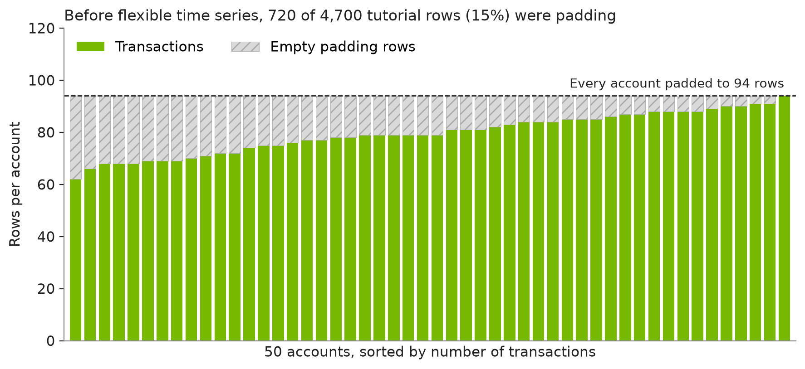
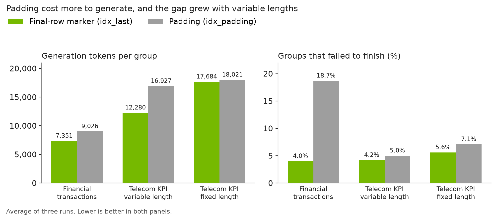
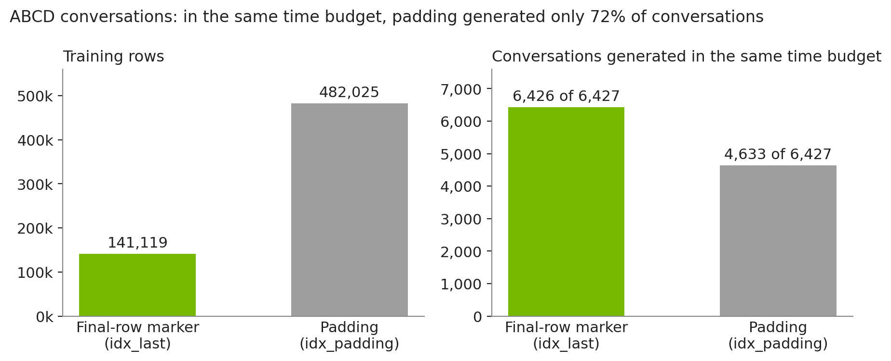

# Flexible Time Series

Sequence data from real-world applications is messy. Bank accounts open and close on different days and transact whenever their owners shop. Support conversations run for six turns or seventy-five. Sensors drop out and come back. Until recently, NeMo Safe Synthesizer's time-series mode required every sequence in a dataset to look the same, with the same length, the same start and stop time, and the same fixed interval between records.

That requirement is gone now. As of release `v0.1.15`, time-series mode accepts groups with different lengths, different start and stop times, and irregular intervals. There is no new setting to turn on. You point NeMo Safe Synthesizer at your data, configure the timestamp column, and it learns where each sequence begins, how it moves through time, and when it ends.

<!-- more -->

In this dev note, we cover why the old rules existed, what the workaround cost, how flexible processing works, and the experiments that decided how the model learns when a sequence ends.

## How Time Series Mode Used to Work

Time-series mode was built for a simple setting. If every group shares the same start time, stop time, interval, and length, the generator can calculate exactly how many rows each synthetic group needs. It starts at the common start timestamp, steps forward by the interval, and stops at the common stop timestamp. The model never has to decide when a sequence is finished.

That design works well for synchronized data, such as a fleet of sensors that all report every 15 minutes over the same day. It breaks down for most other ordered data.

- Transaction histories have irregular timing. A customer may make three purchases in an hour and then none for a week.
- Accounts, devices, and users join and leave at different times, so their histories start and stop on different dates.
- Conversations and event logs vary in length, and their order comes from each step's position in a workflow.

Users asked us how to use the library for exactly these styles of input data, but the workaround was awkward, requiring the user to preprocess the data manually so every group looked identical.

### The cost of padding every sequence to one length

Our own [financial transactions case study](does-nemo-safe-synthesizer-actually-work.md) is a good example. Its transaction ledger was generated for that case study and contains no real customer data. In a deployment, the input data would be your organization's own records. The ledger's 50 accounts hold between 62 and 94 transactions each, with irregular timestamps. To run it in time-series mode, the tutorial dataset padded every account to 94 rows and added a `txn_index` column, numbered 1 to 94 in each account, to stand in for the timestamp.

<figure markdown="span">
  {: style="max-width: 820px; width: 100%; display: block; margin: 1.25rem auto;"}
  <figcaption>Each vertical bar is one account. The green part holds the account's transactions, and the hatched part is padding added to reach 94 rows. Shorter accounts had up to 32 empty rows.</figcaption>
</figure>

The workaround had three costs.

- 720 of 4,700 training rows, about 15%, contained no transaction at all, and the model still had to learn them.
- The model also had to generate the padding rows for every shorter account. Generation is often the slowest step in time-series mode, so every unused token made that step slower.
- The synthetic output could contain padding rows, so users had to remove them manually from the output of NeMo Safe Synthesizer before any analysis.

## How Flexible Time Series Works

### Checking whether sequences are identical

During training preprocessing, NeMo Safe Synthesizer checks the four conditions that the original design required.

- Do all groups have the same number of records?
- Do all groups start at the same timestamp?
- Do all groups stop at the same timestamp?
- Is there one consistent interval within and across groups?

If every answer is yes, the library keeps to the original code path for deterministic sequence timing. The endpoint can be calculated directly, so there is nothing for the model to learn about stopping. If any answer is no, the library takes the flexible path. We call this check routing.

### Teaching the model where each sequence ends

The flexible path adds two internal columns to the training data.

- `_time_idx` counts rows within each group, starting at 0. Generation checks that each new row advances it by exactly one.
- `_is_last_row` is `True` on each group's final row and `False` everywhere else.

Here are the last five rows of one account in the training data.

```csv
acct_id,_time_idx,_is_last_row,cardholder,state,timestamp,merchant_cat,merchant,txn_amount
ACCT-013E4482,70,False,Alexis Parsons,CA,2025-01-28 19:54:09,entertainment,AMC Theatres,87.39
ACCT-013E4482,71,False,Alexis Parsons,CA,2025-01-28 22:20:56,entertainment,AMC Theatres,61.56
ACCT-013E4482,72,False,Alexis Parsons,CA,2025-01-29 17:31:22,retail,Target,139.57
ACCT-013E4482,73,False,Alexis Parsons,CA,2025-01-31 07:44:11,subscription,Netflix,19.99
ACCT-013E4482,74,True,Alexis Parsons,CA,2025-01-31 16:01:55,grocery,Whole Foods Market,87.15
```

The source `timestamp` stays in the data as an ordinary generated column, so each synthetic account keeps its own irregular timing. `_time_idx` gives the generator a regular step to check, and `_is_last_row` teaches the model what a final transaction looks like.

During generation, each group grows one row at a time.

- A row is accepted only if `_time_idx` advances by one and the source timestamp does not go backward.
- The group ends at the first accepted row with `_is_last_row` set to `True`.
- The longest group seen in training acts as a hard cap, so a sequence that never emits the marker still stops.
- Before the synthetic data is returned from the library, both internal columns are removed and the original column order is restored.

Generation is `COMPLETE` only when every group finishes. Rows from groups that fail are discarded, so the output never contains partial sequences.

## Marking the Last Row vs. Padding Every Sequence

Before building the feature, we ran a series of experiments to decide how the model should learn where a sequence ends. We compared two representations, and both used the same `_time_idx` column.

- The final-row marker, `idx_last`, adds `_is_last_row` as shown above. No rows are added.
- Padding, `idx_padding`, extends every group to the longest group's length with rows whose source fields are all empty. The first empty row the model generates ends the group.

Padding is a cleaner, automated version of the old workaround. Below is a subset of rows for an account with 62 transactions in a dataset whose longest account has 94. `_time_idx` starts at 0, so the transactions fill rows 0 to 61 and padding fills rows 62 to 93.

```csv
acct_id,_time_idx,cardholder,state,timestamp,merchant_cat,merchant,txn_amount
...
ACCT-B925FC47,59,Jermaine Nguyen,CA,2025-01-30 15:31:53,grocery,Whole Foods Market,97.71
ACCT-B925FC47,60,Jermaine Nguyen,CA,2025-01-30 18:02:57,dining,Chipotle Mexican Grill,52.58
ACCT-B925FC47,61,Jermaine Nguyen,CA,2025-01-30 19:25:41,entertainment,AMC Theatres,32.28
ACCT-B925FC47,62,,,,,,
ACCT-B925FC47,63,,,,,,
...
ACCT-B925FC47,93,,,,,,
```

### Datasets and test setup

We tested both approaches on four datasets. Two come from earlier dev notes. The other two are versions of a synthetic telecom KPI dataset that we built internally for evaluation only.

| Dataset | Rows | Groups | Rows per group | Order |
|---|---:|---:|---|---|
| [Financial transactions](does-nemo-safe-synthesizer-actually-work.md) | 3,980 | 50 accounts | 62 to 94, median 79 | Irregular timestamps |
| Telecom KPI, fixed length | 23,040 | 240 cells | 96 for every cell | Every 15 minutes |
| Telecom KPI, variable length | 14,340 | 240 cells | 24 to 96, median 60 | Every 15 minutes |
| [ABCD conversations](abcd-conversations-to-synthetic-training-data.md) | 176,434 | 8,034 conversations | 6 to 75, median 21 | Turn position |

The two telecom datasets act as a controlled pair. The fixed-length version meets all four conditions, so in production it takes the deterministic path. We ran both approaches on it anyway to see whether learning the endpoint helps when the endpoint is already known. The variable-length version keeps one contiguous subwindow from each group, so groups start and stop at different times and have different lengths, while every interval stays exactly 15 minutes. That separates the effect of variable length from the effect of irregular timing.

Both approaches ran under the same conditions.

- Each approach fine-tuned `HuggingFaceTB/SmolLM3-3B` with the same optimizer, decoding, retry, and hardware settings.
- We ran each approach three times, with a different random seed for training and generation on each run.
- The generator never received a group's length from the training data. Each group shared only the dataset-level cap, so any match to the training lengths had to be learned.
- A group counted as failed after three consecutive batches in which at least 80% of records were invalid or no new row was accepted.
- Token counts include prompts, retries, and discarded completions, so they reflect the full cost of producing each group.
- For ABCD, models trained on a 6,427-conversation split of the training data with 141,119 rows.

### Marking the last row was cheaper and failed less often

Padding required more generation tokens on every dataset where both approaches finished, and the gap grew when group lengths varied.

{: style="max-width: 860px; width: 100%; display: block; margin: 1.25rem auto;"}

Lower is better in both panels. Padding used 23% more generation tokens per account on financial transactions and 38% more per group on variable-length telecom KPI. On variable-length telecom KPI, the final-row marker also used 31.6% fewer training tokens, because short groups no longer include padding rows. Padding also failed more often. The gap was largest on financial transactions, where padding failed on almost one in five accounts and the marker failed on one in twenty-five. Padding also took longer to generate each group, most of all on variable-length telecom KPI, at 4.20 seconds per group compared with 3.09 for the final-row marker.

ABCD has the widest spread of lengths, from 6 to 75 turns, and that is where padding cost the most.

{: style="max-width: 820px; width: 100%; display: block; margin: 1.25rem auto;"}

Padding extended all 6,427 training conversations to the 75-turn maximum, increasing the training data from 141,119 to 482,025 rows. Padding was also slower. Training took 47.6 minutes, compared with 20.4 minutes for `idx_last`. Both approaches ran with the same time budget. The final-row marker finished all three runs within it, completing generation in about 38 minutes at 2,094 generation tokens per conversation, with about one conversation per run failing to finish. The first padding run timed out after generating 4,633 of the 6,427 conversations, about 72%, so we did not run padding again.

| Dataset | Approach | Groups failed | Generation tokens per group | Generation seconds per group | Mean generated length | Mean training length |
|---|---|---:|---:|---:|---:|---:|
| Financial transactions | `idx_last` | 4.0% | 7,351 | 2.70 | 85.4 | 79.6 |
| Financial transactions | `idx_padding` | 18.7% | 9,026 | 3.15 | 85.4 | 79.6 |
| Telecom KPI, variable length | `idx_last` | 4.2% | 12,280 | 3.09 | 64.1 | 59.9 |
| Telecom KPI, variable length | `idx_padding` | 5.0% | 16,927 | 4.20 | 73.8 | 59.9 |
| Telecom KPI, fixed length | `idx_last` | 5.6% | 17,684 | 4.56 | 92.1 | 96.0 |
| Telecom KPI, fixed length | `idx_padding` | 7.1% | 18,021 | 4.67 | 90.5 | 96.0 |
| ABCD conversations | `idx_last` | 0.016% | 2,094 | 0.35 | 21.3 | 22.0 |
| ABCD conversations | `idx_padding` | Timed out | — | — | — | 22.0 |

Results are averages of three runs, except ABCD padding, which ran once. Generation seconds per group is the wall-clock generation time on one H100 divided by the number of requested groups, excluding model loading and evaluation. It depends on how many groups are generated in parallel, so compare it within a dataset. ABCD looks fastest because it generates 6,427 short groups in large batches. Token counts are the comparable measure across datasets.

The final-row marker also tracked training lengths more closely when lengths varied. Without receiving any group's length, it produced ABCD conversations within one turn of the training average. On variable-length telecom KPI, it averaged 64.1 records per group against 59.9 in the training data, while padding ran to 73.8. On financial transactions, both approaches generated accounts about six transactions longer than the training average. Both telecom datasets kept valid, in-order timestamps with exact 15-minute intervals under either approach.

### Why identical sequences keep the original method

The fixed-length telecom dataset is the control. Every group has exactly 96 records, so padding adds no rows at all. The two approaches came out nearly tied, with generation tokens within 2% of each other. Neither reproduced the length exactly. The final-row marker averaged 92.1 records per group, and padding averaged 90.5.

The deterministic path does not have to guess. It calculates each group's endpoint from the shared start, stop, and interval. When all four checks pass, learning the endpoint adds work without a benefit, so NeMo Safe Synthesizer keeps the deterministic path for fixed-shape data and uses the final-row marker for everything else.

## Takeaways

- Time-series mode now accepts sequences as they are. Groups can differ in length, start time, stop time, and interval, with no new configuration.
- Routing is automatic. Fixed-shape data keeps deterministic generation, and everything else learns its own endpoint through a final-row marker.
- No padding is needed. In our experiments, the final-row marker used fewer generation tokens and failed less often than padding on every dataset where both completed. On ABCD, with the same time budget, the final-row marker finished while padding timed out after generating 72% of the conversations.

## Try It

The [financial transactions tutorial](../../tutorials/time-series-financial-transactions.ipynb) now runs on the raw transaction ledger, with its original irregular timestamps and no padding. The [time-series configuration reference](../../user-guide/configuration.md#time-series) covers the timestamp and interval settings, and the [time-series troubleshooting guide](../../user-guide/troubleshooting.md#time-series) explains common validation errors.

Have a sequence dataset that still does not fit? Open a [GitHub discussion](https://github.com/NVIDIA-NeMo/Safe-Synthesizer/discussions) or file a [feature request](https://github.com/NVIDIA-NeMo/Safe-Synthesizer/issues).
