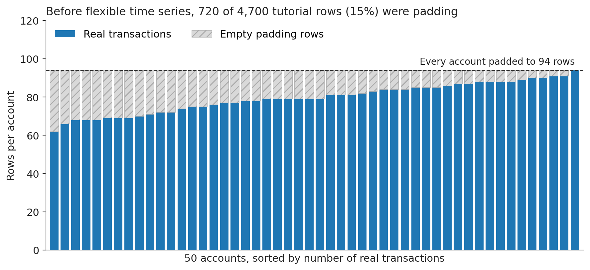
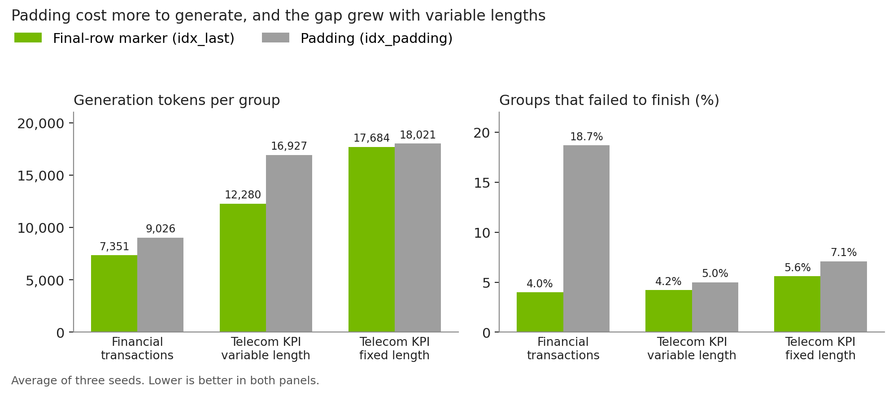
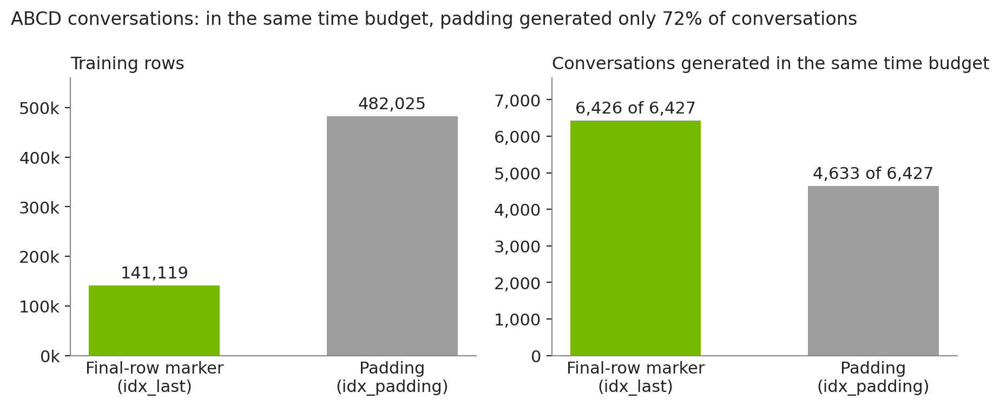

# Flexible Time Series in NeMo Safe Synthesizer: Bring Your Sequences As They Are

Real sequences are messy. Bank accounts open and close on different days and transact whenever their owners shop. Support conversations run for six turns or seventy-five. Sensors drop out and come back. Until recently, NeMo Safe Synthesizer time-series mode asked every sequence in a dataset to look the same, with the same length, the same start and stop time, and the same fixed interval between records.

That requirement is gone. Time-series mode now accepts groups with different lengths, different start and stop times, and irregular intervals. There is no new setting to turn on. You point NeMo Safe Synthesizer at your timestamp column, and it learns where each sequence begins, how it moves through time, and when it ends.

<!-- more -->

Flexible time series shipped in NeMo Safe Synthesizer `v0.1.15`. In this dev note, we cover why the old rules existed, what the workaround cost, how flexible processing works, and the research spike that decided how the model learns when a sequence ends.

## The Four Rules Time Series Used to Follow

Time-series mode was built on a simple idea. If every group shares the same start time, stop time, interval, and length, the generator can calculate exactly how many rows each synthetic group needs. It starts at the common start timestamp, steps forward by the interval, and stops at the common stop timestamp. The model never has to decide when a sequence is finished.

That design works well for synchronized data, such as a fleet of sensors that all report every 15 minutes over the same day. It breaks down for most other ordered data.

- Transaction histories have irregular timing. A customer may make three purchases in an hour and then none for a week.
- Accounts, devices, and users join and leave at different times, so their histories start and stop on different dates.
- Conversations and event logs vary in length, and their order is a position in a workflow rather than a wall-clock interval.

Users asked us for exactly these cases. The only way to fit them into the old pipeline was to reshape the data by hand until every group looked identical.

### What the workaround cost

Our own [financial transactions case study](does-nemo-safe-synthesizer-actually-work.md) is a good example. Its 50 accounts hold between 62 and 94 real transactions each, with irregular timestamps. To run it in time-series mode, the tutorial dataset padded every account to 94 rows and added a `txn_index` column, numbered 1 to 94 in each account, to stand in for the timestamp.

{: style="max-width: 820px; width: 100%; display: block; margin: 1.25rem auto;"}

Each bar is one account. The blue part is real transactions, and the hatched part is padding added to reach 94 rows. Shorter accounts carried up to 32 empty rows.

The workaround had three costs.

- Wasted training data: 720 of 4,700 rows, about 15%, carried no transaction at all, and the model still had to learn them.
- Wasted generation: the model also had to generate the padding rows for every shorter account. Generation tokens cost more than training tokens, because the model produces them one at a time.
- Cleanup after generation: synthetic output could contain padded rows, so the tutorial had to filter them before any analysis.

## How It Works

### Automatic routing

During training preprocessing, NeMo Safe Synthesizer checks the four rules from the previous section.

- Do all groups have the same number of records?
- Do all groups start at the same timestamp?
- Do all groups stop at the same timestamp?
- Is there one consistent interval within and across groups?

If every answer is yes, the data keeps the original deterministic path. The endpoint can be calculated directly, so there is nothing for the model to learn about stopping. If any answer is no, the data takes the flexible path.

### Learning where each sequence ends

The flexible path adds two internal columns to the training data.

- `_time_idx` counts rows within each group, starting at 0. Generation checks that each new row advances it by exactly one.
- `_is_last_row` is `true` on each group's final real row and `false` everywhere else.

Here are the last five rows of one real account in the training data.

```csv
acct_id,_time_idx,cardholder,state,timestamp,merchant_cat,merchant,txn_amount,_is_last_row
ACCT-013E4482,70,Alexis Parsons,CA,2025-01-28 19:54:09,entertainment,AMC Theatres,87.39,False
ACCT-013E4482,71,Alexis Parsons,CA,2025-01-28 22:20:56,entertainment,AMC Theatres,61.56,False
ACCT-013E4482,72,Alexis Parsons,CA,2025-01-29 17:31:22,retail,Target,139.57,False
ACCT-013E4482,73,Alexis Parsons,CA,2025-01-31 07:44:11,subscription,Netflix,19.99,False
ACCT-013E4482,74,Alexis Parsons,CA,2025-01-31 16:01:55,grocery,Whole Foods Market,87.15,True
```

The real `timestamp` stays in the data as an ordinary generated column, so each synthetic account keeps its own irregular timing. `_time_idx` gives the generator a regular step to check, and `_is_last_row` teaches the model what a final transaction looks like.

During generation, each group grows one row at a time.

- A row is accepted only if `_time_idx` advances by one and the source timestamp does not go backward.
- The group ends at the first accepted row with `_is_last_row` set to `true`.
- The longest group seen in training acts as a hard cap, so a sequence that never emits the marker still stops.
- Both control columns are removed, and the original column order is restored before the data is returned.

Generation is `COMPLETE` only when every group finishes. Rows from groups that fail are discarded rather than returned as partial sequences.

## Why a Final-Row Marker

Before building the feature, we ran a research spike to decide how the model should learn where a sequence ends. We compared two representations, and both used the same `_time_idx` column.

- Final-row marker, `idx_last`: add `_is_last_row` as shown above. No rows are added.
- Padding, `idx_padding`: extend every group to the longest group's length with rows whose source fields are all empty. The first empty row the model generates ends the group.

Padding is a cleaner, automated version of the old workaround. Here is how it would look for an account with 62 real transactions in a dataset whose longest account has 94.

```csv
acct_id,_time_idx,cardholder,state,timestamp,merchant_cat,merchant,txn_amount
ACCT-B925FC47,59,Jermaine Nguyen,CA,2025-01-30 15:31:53,grocery,Whole Foods Market,97.71
ACCT-B925FC47,60,Jermaine Nguyen,CA,2025-01-30 18:02:57,dining,Chipotle Mexican Grill,52.58
ACCT-B925FC47,61,Jermaine Nguyen,CA,2025-01-30 19:25:41,entertainment,AMC Theatres,32.28
ACCT-B925FC47,62,,,,,,
ACCT-B925FC47,63,,,,,,
```

### Setup

We tested both approaches on four datasets. Two come from earlier dev notes. The other two are versions of a synthetic telecom KPI dataset that we built internally for evaluation only.

| Dataset | Rows | Groups | Rows per group | Order |
|---|---:|---:|---|---|
| [Financial transactions](does-nemo-safe-synthesizer-actually-work.md) | 3,980 | 50 accounts | 62 to 94, median 79 | Irregular timestamps |
| Telecom KPI, fixed length | 23,040 | 240 cells | 96 for every cell | Every 15 minutes |
| Telecom KPI, variable length | 14,340 | 240 cells | 24 to 96, median 60 | Every 15 minutes |
| [ABCD conversations](abcd-conversations-to-synthetic-training-data.md) | 176,434 | 8,034 conversations | 6 to 75, median 21 | Turn position |

The two telecom datasets act as a controlled pair. The fixed-length version meets all four rules, so in production it takes the deterministic path. We ran both learned approaches on it anyway to see whether learning the endpoint helps when the endpoint is already known. The variable-length version keeps one contiguous window from each cell, so cells start and stop at different times and have different lengths, while every interval stays exactly 15 minutes. That separates the effect of variable length from the effect of irregular timing.

All approaches fine-tuned `HuggingFaceTB/SmolLM3-3B` with the same optimizer, decoding, retry, and hardware settings, across three seeds. The generator never received a group's real length. Each group shared only the dataset-level cap, so any match to the real lengths had to be learned. A group counted as failed after three consecutive batches in which at least 80% of records were invalid or the timestamp did not advance. Token counts include prompts, retries, and discarded completions, so they reflect the full cost of producing each group. For ABCD, models trained on a 6,427-conversation split of the training data with 141,119 rows.

### Results

All results are averages of three seeds.

Padding cost more to generate on every dataset where both approaches finished, and the gap grew when group lengths varied.

{: style="max-width: 860px; width: 100%; display: block; margin: 1.25rem auto;"}

Lower is better in both panels. Padding used 23% more generation tokens per account on financial transactions and 38% more per cell on variable-length telecom KPI. On variable-length telecom KPI, the final-row marker also used 31.6% fewer training tokens, because short cells no longer carry padded rows. Padding also failed more often. The gap was largest on financial transactions, where padding failed on almost one in five accounts and the marker failed on one in twenty-five.

ABCD has the widest spread of lengths, from 6 to 75 turns, and that is where padding cost the most. Padding was not only less token efficient. It was also slower.

{: style="max-width: 820px; width: 100%; display: block; margin: 1.25rem auto;"}

Padding extended all 6,427 training conversations to the 75-turn maximum, growing the training data from 141,119 to 482,025 rows, and training alone took 47.6 minutes. Both approaches ran with the same time budget. The final-row marker finished all three seeds within it, at 2,094 generation tokens per conversation and with about one conversation per seed failing to finish. In that same time, the first padding seed generated only 4,633 of the 6,427 conversations, about 72%, so we did not run the other two padding seeds.

| Dataset | Approach | Groups failed | Generation tokens per group | Mean generated length | Mean real length |
|---|---|---:|---:|---:|---:|
| Financial transactions | `idx_last` | 4.0% | 7,351 | 85.4 | 79.6 |
| Financial transactions | `idx_padding` | 18.7% | 9,026 | 85.4 | 79.6 |
| Telecom KPI, variable length | `idx_last` | 4.2% | 12,280 | 64.1 | 59.9 |
| Telecom KPI, variable length | `idx_padding` | 5.0% | 16,927 | 73.8 | 59.9 |
| Telecom KPI, fixed length | `idx_last` | 5.6% | 17,684 | 92.1 | 96.0 |
| Telecom KPI, fixed length | `idx_padding` | 7.1% | 18,021 | 90.5 | 96.0 |
| ABCD conversations | `idx_last` | 0.016% | 2,094 | 21.3 | 22.0 |
| ABCD conversations | `idx_padding` | Did not finish (72% generated) | — | — | 22.0 |

The final-row marker also tracked real lengths more closely when lengths varied. Without seeing any real lengths, it produced ABCD conversations within one turn of the real average, and on variable-length telecom KPI it averaged 64.1 records per cell against a real 59.9, while padding ran to 73.8. On financial transactions, both approaches generated accounts about six transactions longer than the real average. Both telecom datasets kept valid, in-order timestamps with exact 15-minute intervals under either approach.

### Why fixed-shape data stays deterministic

The fixed-length telecom dataset is the control. Every cell has exactly 96 records, so padding adds no rows at all. The two learned approaches came out nearly tied, with generation tokens within 2% of each other. Neither reproduced the length exactly. The final-row marker averaged 92.1 records per cell, and padding averaged 90.5.

The deterministic path does not have to guess. It calculates each group's endpoint from the shared start, stop, and interval. When all four checks pass, learning the endpoint adds work without a benefit, so NeMo Safe Synthesizer keeps the deterministic path for fixed-shape data and uses the final-row marker for everything else.

## Takeaways

- Time-series mode now accepts sequences as they are. Groups can differ in length, start time, stop time, and interval, with no new configuration.
- Routing is automatic. Fixed-shape data keeps deterministic generation, and everything else learns its own endpoint through a final-row marker.
- No padding is needed. In our research spike, the final-row marker used fewer generation tokens and failed less often than padding on every dataset where both completed. On ABCD, with the same time budget, the final-row marker finished while padding generated only 72% of the conversations.

## Try It

The [financial transactions tutorial](../../tutorials/time-series-financial-transactions.ipynb) now runs on the raw transaction ledger, with real timestamps and no padding. The [time-series configuration reference](../../user-guide/configuration.md#time-series) covers the timestamp and interval settings, and the [time-series troubleshooting guide](../../user-guide/troubleshooting.md#time-series) explains common validation errors.

Have a sequence dataset that still does not fit? Open a [GitHub discussion](https://github.com/NVIDIA-NeMo/Safe-Synthesizer/discussions) or file a [feature request](https://github.com/NVIDIA-NeMo/Safe-Synthesizer/issues).
