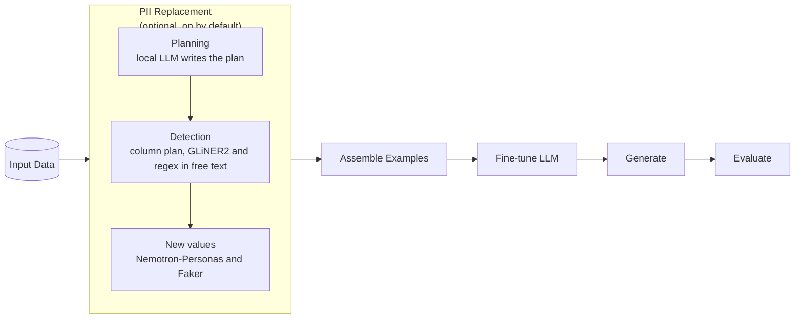

# Replacing Identifiers in Tabular Data Before Training

NeMo Safe Synthesizer replaces personally identifiable information (PII) in the training data it fine-tunes on by default. We just released version 0.2.0, with a brand-new implementation of the PII replacement step that is designed for tabular data. It improves the user experience and quality of PII replacement in three major ways:

1. **Simpler configuration.** An auto-discovered replacement plan is the default.
2. **Better detection accuracy.** Detection emphasizes fewer false positives. It replaces only the direct identifiers that would be a concern if they showed up in generated data.
3. **Consistent replacement values across rows and columns.** A new email follows the new name it is built from. A repeated value, such as a first name in a notes column, gets the same replacement everywhere it appears. When most cells in a column share a format, the new values follow that format.

Treat PII replacement as a pre-processing step, not a standalone anonymizer. We keep quasi-identifiers, such as gender and ethnicity, unchanged. These columns rarely identify someone on their own, and the rest of the pipeline generates new records, so the privacy risk of keeping them is low. For stronger standalone anonymization, see our sister library, [NeMo Anonymizer](https://github.com/NVIDIA-NeMo/Anonymizer).

The rows below come from the simulated hospital admissions table in the [review tutorial](../../tutorials/pii-replacement-review.ipynb).

<!-- more -->

## One Admission

In this admission, direct identifiers (name, email, phone, street address, date of birth, and medical record number) change. Quasi-identifiers (city, sex, and attending physician) stay. The discharge note keeps the clinical text and uses the same new name, shifted date of birth, and new medical record number as the columns.

| Column | Before | After |
|---|---|---|
| `full_name` | Quyen Roxas Truong | Phi Tran |
| `email` | truongq16@gmail.com | phi.tran64@gmail.com |
| `phone` | 813-421-0211 | 813-750-3946 |
| `address` | 127 Dylan Dr Suite 104 | 99 Range Rd |
| `date_of_birth` | 1978-02-16 | 1978-03-28 |
| `mrn` | `MRN-29FD1584F9` | `MRN-2ET7CSBZD0` |
| `city` | Tampa | Tampa |
| `sex` | Female | Female |
| `attending_physician` | Kari Mcdonald | Kari Mcdonald |
| `discharge_summary` (first sentence) | Patient Quyen Roxas Truong (DOB 1978-02-16, MRN-29FD1584F9) arrived at the emergency department on 2024-03-06T15:00:00 and was admitted as an inpatient the same day. | Patient Phi Tran (DOB 1978-03-28, MRN-2ET7CSBZD0) arrived at the emergency department on 2024-03-06T15:00:00 and was admitted as an inpatient the same day. |

The new email is built from Phi Tran and keeps the original `gmail.com` domain. The note names Phi Tran, uses 1978-03-28, and uses `MRN-2ET7CSBZD0`. The rest of the note is unchanged, including the creatinine result, the sodium bicarbonate prescription, and the readmission plan.

## The New Names Match Sex and Ethnicity

This row is female and southeast Asian, so the new name (Phi Tran) matches both its sex and its ethnicity. When a dataset clearly indicates the gender or ethnicity of a name column, we can sample replacement names that match those demographics.

## The Same Format Down the Column

The same rules hold across rows, not only inside one record. These five admissions show the pattern within each column.

Before replacement, the five admissions look like this.

| Name | Email | Phone | MRN | Date of birth |
|---|---|---|---|---|
| Debra Colleen Douglas | debradouglas16@gmail.com | 816-946-0221 | `MRN-579141BE6A` | 1965-07-16 |
| Abdiel Alcides Ortega | aortega@icloud.com | 442-389-4445 | `MRN-34A5274363` | 1965-01-16 |
| Ronald Tyrell Gause | ronaldgause@gmail.com | 651-824-8212 | `MRN-F93D5EA3A4` | 1955-12-12 |
| Anthony Hoffner Cain | anthony_cain97@icloud.com | 502-542-9479 | `MRN-7E53D98F0F` | 1997-03-01 |
| Omaris Veronica Alaniz | omaris.alaniz@icloud.com | 310-313-8225 | `MRN-8E5D7502C3` | 1966-12-02 |

After replacement, the same five admissions look like this.

| Name | Email | Phone | MRN | Date of birth |
|---|---|---|---|---|
| Carolina Peters | carolina.peters35@gmail.com | 816-426-9133 | `MRN-76STWN8HLK` | 1965-08-10 |
| Julio Medina | julio.medina67@icloud.com | 442-503-3940 | `MRN-N8BXZW94H1` | 1965-01-29 |
| Bryan Bonnie | bryan.bonnie89@gmail.com | 651-932-5860 | `MRN-BED9N71V0G` | 1955-11-16 |
| William Naini | william.naini17@icloud.com | 502-412-5881 | `MRN-F135GZZ0EA` | 1997-04-08 |
| Manuela Saavedra | manuela.saavedra46@icloud.com | 310-205-2614 | `MRN-RBU9YW3522` | 1966-12-24 |

Across all 9,498 rows, every MRN keeps the `MRN-` prefix and the same length, and every date of birth moves by 146 days or less. Every new email keeps the original domain, and every email local part contains a part of the new name. Every phone uses the `###-###-####` layout, and phones keep their area code when the source number is in that layout.

## What This Run Replaced

This run rewrote identifiers and the free text that repeats them. It left columns that describe a person without identifying them on their own, along with the clinical fields and the ordinary dates.

| Replaced | Left unchanged |
|---|---|
| `patient_id`, `mrn`, `full_name`, `date_of_birth`, `phone`, `email`, `address`, `discharge_summary` | `admission_id`, `city`, `state`, `postal_code`, `sex`, `race_ethnicity`, admission and discharge dates, diagnosis, labs, charges, `attending_physician` |

Leaving those columns alone matters. Replacing a city, a diagnosis, or a lab value would change the patterns the model is supposed to learn. The final synthetic data come from freshly generated records, after this pre-processing step and LLM fine-tuning.

These results assume the PII replacement plan correctly identifies all PII columns, their patterns, and their dependencies. Each auto-discovery run is stochastic and could create a plan that is slightly different. See the note or the [review tutorial](../../tutorials/pii-replacement-review.ipynb) for reviewing and editing an auto-discovered plan.

## Where Replacement Sits

Replacement is one stage in the same pipeline as the rest of a NeMo Safe Synthesizer run. Inside that stage, planning produces the replacement plan, detection finds PII in free-text columns, and new values are written before examples are assembled.

Planning runs in a local vLLM server on the machine's GPU. vLLM is a library for serving language models, so the column samples used for planning stay there. The local model needs a GPU with about 80 GB of memory and downloads about 66 GB the first time. A hosted endpoint is optional, and it does send those column samples to the service.

Structured columns follow the plan. In free-text columns, such as notes, GLiNER2 finds PII spans, and regex checks catch email addresses, payment card numbers, and IP addresses. Names and street addresses come from Nemotron-Personas. Faker fills in the rest and is also the fallback when the Nemotron-Personas data for the locale is not installed.

## Next Steps

The next note covers the plan. It shows how to read it, change it, and train with the version you reviewed. The [review tutorial](../../tutorials/pii-replacement-review.ipynb) is the runnable version of the same workflow.

Have questions or want to share what you are building? Open a [GitHub discussion](https://github.com/NVIDIA-NeMo/Safe-Synthesizer/discussions) or file a [feature request](https://github.com/NVIDIA-NeMo/Safe-Synthesizer/issues).
