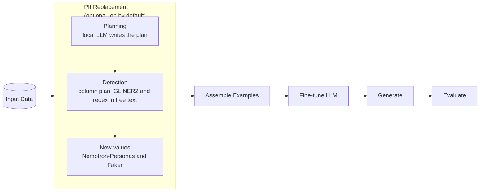

# Replacing Identifiers in Tabular Data Before Training

NeMo Safe Synthesizer replaces personally identifiable information (PII) in the training data it fine-tunes on by default. We just released version 0.2.0, with a brand-new implementation of the PII replacement step that is designed for tabular data. It improves the user experience and quality of PII replacement in three major ways:

1. **Simpler configuration.** An auto-discovered replacement plan is the default. The next note shows how to read and edit that plan.
2. **Consistent replacement across rows and columns.** A new email follows the new name it is built from. A repeated value, such as a first name in a notes column, gets the same replacement everywhere it appears. When most cells in a column share a format, the new values follow that format.
3. **Better detection accuracy.** Detection covers fewer entity types, which cuts false positives, and it is more accurate on the types it still covers.

Treat PII replacement as a pre-processing step, not a standalone anonymizer. We keep quasi-identifiers, such as gender and ethnicity, unchanged. These columns rarely identify someone on their own, and the rest of the pipeline generates new records, so the privacy risk of keeping them is low. For stronger standalone anonymization, see our sister library, [NeMo Anonymizer](https://github.com/NVIDIA-NeMo/Anonymizer).

The row below comes from the simulated hospital admissions table in the [review tutorial](../../tutorials/pii-replacement-review.ipynb).

<!-- more -->

## Example
Here's an example of one admission record, before and after PII replacement. A repeated value keeps one color. The replacement of an entity is a darker shade of that color. Quyen and the q in the original email share a color, and Phi and phi are a darker shade of it. The date of birth and the medical record number follow the same rule in the table and in the discharge note.

| Column | Before | After |
|---|---|---|
| `full_name` | Quyen Roxas Truong | Phi Tran |
| `email` | truongq16@gmail.com | phi.tran64@gmail.com |
| `phone` | 813-421-0211 | 813-750-3946 |
| `address` | 127 Dylan Dr Suite 104 | 99 Range Rd |
| `date_of_birth` | 1978-02-16 | 1978-03-28 |
| `mrn` | MRN-29FD1584F9 | MRN-2ET7CSBZD0 |
| `city` | Tampa | Tampa |
| `sex` | Female | Female |
| `attending_physician` | Kari Mcdonald | Kari Mcdonald |
| `discharge_summary` | Patient Quyen Roxas Truong (DOB 1978-02-16, MRN-29FD1584F9) arrived at the emergency department on 2024-03-06T15:00:00 and was admitted as an inpatient the same day. | Patient Phi Tran (DOB 1978-03-28, MRN-2ET7CSBZD0) arrived at the emergency department on 2024-03-06T15:00:00 and was admitted as an inpatient the same day. |

### Consistent Replacement
The new email is built from Phi Tran and keeps the original `gmail.com` domain. The rest of the discharge note is unchanged, including the creatinine result, the sodium bicarbonate prescription, and the readmission plan.

### The New Names Match Sex and Ethnicity

<svg xmlns="http://www.w3.org/2000/svg" viewBox="0 0 680 250" role="img" aria-label="Quyen Roxas Truong is replaced by Phi Tran. Sex Female and ethnicity Southeast Asian both point to Phi Tran." style="max-width: 640px; width: 100%; height: auto; display: block; margin: 1.25rem auto;">
  <defs>
    <marker id="name-arrow" viewBox="0 0 10 10" refX="9" refY="5" markerWidth="7" markerHeight="7" orient="auto-start-reverse">
      <path d="M 0 1 L 10 5 L 0 9 z" fill="#333"/>
    </marker>
  </defs>
  <rect x="250" y="28" width="250" height="48" rx="8" fill="#FDE0C4" stroke="#E4C6A6"/>
  <text x="375" y="57" text-anchor="middle" font-family="Roboto, sans-serif" font-size="16" fill="#111">Quyen Roxas Truong</text>
  <line x1="375" y1="76" x2="375" y2="128" stroke="#333" stroke-width="1.5" marker-end="url(#name-arrow)"/>
  <rect x="24" y="118" width="176" height="44" rx="8" fill="#fff" stroke="#d0d0d0"/>
  <text x="112" y="138" text-anchor="middle" font-family="Roboto, sans-serif" font-size="11" fill="#666">Gender</text>
  <text x="112" y="154" text-anchor="middle" font-family="Roboto, sans-serif" font-size="15" fill="#111">Female</text>
  <rect x="24" y="176" width="176" height="44" rx="8" fill="#fff" stroke="#d0d0d0"/>
  <text x="112" y="196" text-anchor="middle" font-family="Roboto, sans-serif" font-size="11" fill="#666">Ethnicity</text>
  <text x="112" y="212" text-anchor="middle" font-family="Roboto, sans-serif" font-size="15" fill="#111">Southeast Asian</text>
  <rect x="250" y="136" width="250" height="56" rx="8" fill="#E09A45" stroke="#C4842E"/>
  <text x="375" y="169" text-anchor="middle" font-family="Roboto, sans-serif" font-size="16" fill="#111">Phi Tran</text>
  <line x1="200" y1="140" x2="242" y2="152" stroke="#333" stroke-width="1.5" marker-end="url(#name-arrow)"/>
  <line x1="200" y1="198" x2="242" y2="176" stroke="#333" stroke-width="1.5" marker-end="url(#name-arrow)"/>
</svg>

This row is female and southeast Asian, so the new name (Phi Tran) matches both its sex and its ethnicity. When a dataset clearly indicates the gender or ethnicity of a name column, we can sample replacement names that match those demographics.

### The Same Layouts Hold Down the Column

Across all 9,498 rows, every MRN keeps the `MRN-` prefix and the same length, every date of birth moves by 146 days or less, every email keeps the original domain and contains part of the new name, and phones keep the `###-###-####` layout and their area code when the source number uses that layout.

## Improved Detection Accuracy

Detection is limited to direct identifiers and to free text that repeats them. Columns that describe a person without identifying them, along with clinical fields and ordinary dates, are left out. Detecting fewer entity types removes a large class of false positives, so that narrower scope is part of the accuracy gain. The table below shows which columns were detected and replaced in this run.

| Replaced | Left unchanged |
|---|---|
| `patient_id`, `mrn`, `full_name`, `date_of_birth`, `phone`, `email`, `address`, `discharge_summary` | `admission_id`, `city`, `state`, `postal_code`, `sex`, `race_ethnicity`, admission and discharge dates, diagnosis, labs, charges, `attending_physician` |

Leaving those columns unchanged also keeps the patterns the model is supposed to learn. Replacing a city, a diagnosis, or a lab value would change them. The synthetic records are generated later, after this pre-processing step and LLM fine-tuning.

On the entities detection still covers, we tuned the GLiNER2 confidence threshold for each type to favor precision over recall. Regex checks on values with a fixed format, such as emails and UUIDs, remove more false positives. Compared with the previous version, the new version achieves a 37% increase in precision and a 9% increase in recall.

## Where Replacement Sits

PII replacement is one stage in the same pipeline as the rest of a NeMo Safe Synthesizer run. Inside that stage, planning produces the replacement plan, detection finds PII in free-text columns, and new values are written before examples are assembled.

Planning runs in a local vLLM server on the machine's GPU. vLLM is a library for serving language models, so the column samples used for planning stay there. The local model needs a GPU with about 80 GB of memory and downloads about 66 GB the first time. A hosted endpoint is optional, and it does send those column samples to the service.

Structured columns follow the plan. In free-text columns, such as notes, GLiNER2 finds PII spans, and regex checks catch email addresses, payment card numbers, and IP addresses. Names and street addresses come from Nemotron-Personas. Faker fills in the rest and is also the fallback when the Nemotron-Personas data for the locale is not installed.

## Next Steps

The results above assume the replacement plan correctly identifies every PII column, its pattern, and its dependencies. Each auto-discovery run is stochastic and can write a slightly different plan. The next note covers that plan. It shows how to read it, change it, and train with the version you reviewed. The [review tutorial](../../tutorials/pii-replacement-review.ipynb) is the runnable version of the same workflow.

Have questions or want to share what you are building? Open a [GitHub discussion](https://github.com/NVIDIA-NeMo/Safe-Synthesizer/discussions) or file a [feature request](https://github.com/NVIDIA-NeMo/Safe-Synthesizer/issues).
