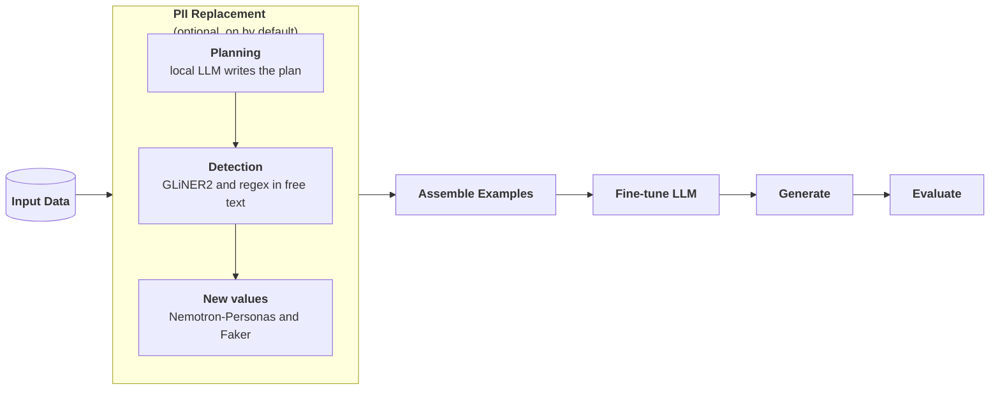

# Replacing Identifiers in Tabular Data Before Training

By default, NeMo Safe Synthesizer replaces personally identifiable information (PII) in the training data before fine-tuning. We just released version 0.2.0, with a brand-new implementation of the PII replacement step that is designed for tabular data. It improves the user experience and quality of PII replacement in three major ways:

1. Simpler configuration. An auto-discovered replacement plan is the default. The next note shows how to read and edit that plan.
2. Consistent content across a row or group, and consistent formatting down a column. A new email follows the replacement name it is built from, and a name repeated in that row's notes matches the name column. Down a column, values that share a format keep it, so medical record numbers keep their prefix and length.
3. Better detection accuracy. Detection covers fewer entity types, which cuts false positives, and it is more accurate on the types it still covers.

Treat PII replacement as a pre-processing step, not a standalone anonymizer. Replacement targets direct identifiers, such as names, street addresses, and ID numbers, so the model does not replay those values. Attributes such as gender stay unchanged. The synthesis step protects them, because it generates new records, so they do not need to be transformed here. For a standalone anonymizer, see [NeMo Anonymizer](https://github.com/NVIDIA-NeMo/Anonymizer).

<!-- more -->

## Context-Preserving Replacements

Here's one admission record from the simulated hospital admissions table in the [tutorial](../../tutorials/pii-replacement-review.ipynb), before and after PII replacement. Each color is one entity. The lighter shade is the original value, and the darker shade is the replacement.

 first name
 middle name
 last name
 phone
 address
 date of birth
 MRN

| Column | Before | After |
|---|---|---|
| `full_name` | Quyen Roxas Truong | Phi Tran |
| `email` | truongq16@gmail.com | phi.tran64@gmail.com |
| `phone` | 813-421-0211 | 813-750-3946 |
| `address` | 127 Dylan Dr Suite 104 | 99 Range Rd |
| `date_of_birth` | 1978-02-16 | 1978-03-28 |
| `mrn` | MRN-29FD1584F9 | MRN-2ET7CSBZD0 |
| `city` | Tampa | Tampa |
| `sex` | Female | Female |
| `attending_physician` | Kari Mcdonald | Kari Mcdonald |
| `discharge_summary` | Patient Quyen Roxas Truong (DOB 1978-02-16, MRN-29FD1584F9) arrived at the emergency department on 2024-03-06T15:00:00 and was admitted as an inpatient the same day. | Patient Phi Tran (DOB 1978-03-28, MRN-2ET7CSBZD0) arrived at the emergency department on 2024-03-06T15:00:00 and was admitted as an inpatient the same day. |

### 1. Consistent Replacement
Each occurrence of the same entity within the record is replaced with the same new value, and each occurrence is highlighted with the same color above. For example, the new email is built from Phi Tran and keeps the original `gmail.com` domain. The patient name in `discharge_summary` also changes to Phi Tran. The rest of the discharge note is unchanged, which could include test results, prescriptions, and readmission plans. If grouping is set in the configuration, such as by account ID across multiple transactions, every row in that group shares the same replacements.

### 2. The New Names Match Gender and Ethnicity

<svg xmlns="http://www.w3.org/2000/svg" viewBox="0 0 680 250" role="img" aria-label="Quyen Roxas Truong is replaced by Phi Tran. Gender Female and ethnicity Southeast Asian both point to Phi Tran." style="max-width: 640px; width: 100%; height: auto; display: block; margin: 1.25rem auto;">
  <defs>
    <marker id="name-arrow" viewBox="0 0 10 10" refX="9" refY="5" markerWidth="7" markerHeight="7" orient="auto-start-reverse">
      <path d="M 0 1 L 10 5 L 0 9 z" fill="#333"/>
    </marker>
  </defs>
  <rect x="250" y="28" width="250" height="48" rx="8" fill="#FDE0C4" stroke="#E4C6A6"/>
  <text x="375" y="57" text-anchor="middle" font-family="Roboto, sans-serif" font-size="16" fill="#111">Quyen Roxas Truong</text>
  <line x1="375" y1="76" x2="375" y2="128" stroke="#333" stroke-width="1.5" marker-end="url(#name-arrow)"/>
  <rect x="24" y="118" width="176" height="44" rx="8" fill="#fff" stroke="#d0d0d0"/>
  <text x="112" y="138" text-anchor="middle" font-family="Roboto, sans-serif" font-size="11" fill="#666">Gender</text>
  <text x="112" y="154" text-anchor="middle" font-family="Roboto, sans-serif" font-size="15" fill="#111">Female</text>
  <rect x="24" y="176" width="176" height="44" rx="8" fill="#fff" stroke="#d0d0d0"/>
  <text x="112" y="196" text-anchor="middle" font-family="Roboto, sans-serif" font-size="11" fill="#666">Ethnicity</text>
  <text x="112" y="212" text-anchor="middle" font-family="Roboto, sans-serif" font-size="15" fill="#111">Southeast Asian</text>
  <rect x="250" y="136" width="250" height="56" rx="8" fill="#E09A45" stroke="#C4842E"/>
  <text x="375" y="169" text-anchor="middle" font-family="Roboto, sans-serif" font-size="16" fill="#111">Phi Tran</text>
  <line x1="200" y1="140" x2="242" y2="152" stroke="#333" stroke-width="1.5" marker-end="url(#name-arrow)"/>
  <line x1="200" y1="198" x2="242" y2="176" stroke="#333" stroke-width="1.5" marker-end="url(#name-arrow)"/>
</svg>

This row is female and southeast Asian, so the new name (Phi Tran) matches both its gender and its ethnicity. When a dataset clearly indicates the gender or ethnicity of a name column, we can sample replacement names that match those demographics.

### 3. Formats Stay Consistent Down a Column

Across all 9,498 rows, every MRN keeps the `MRN-` prefix and the same length, every date of birth moves by 30 days on average, every email keeps the original domain and contains part of the new name, and phones keep the `###-###-####` layout and their area code when the source number uses that layout.

## Improved Detection Accuracy

Detection is limited to direct identifiers and to free text that repeats them. Columns that describe a person without identifying them, along with clinical fields and ordinary dates, are left out. Detecting fewer entity types removes a large class of false positives, so that narrower scope is part of the accuracy gain. The table below shows this run after the plan was reviewed. `attending_physician` was removed from the plan on purpose, so those names stay available for analysis.

| Replaced | Left unchanged |
|---|---|
| `patient_id`, `mrn`, `full_name`, `date_of_birth`, `phone`, `email`, `address`, `discharge_summary` | `admission_id`, `city`, `state`, `postal_code`, `sex`, `race_ethnicity`, admission and discharge dates, diagnosis, labs, charges, `attending_physician` |

Leaving those columns unchanged keeps correlations the synthetic data can learn from. Replacing a city, a diagnosis, or a lab value would make those correlations unreliable. The synthetic records are generated later, after this pre-processing step and LLM fine-tuning.

For the entities that detection still covers, we tuned the GLiNER2 confidence threshold for each type to favor precision over recall. We especially want to minimize false positives, because replacing a word that is not an identifier removes information the model should learn, and the new word often makes the sentence nonsensical. A missed identifier, a false negative, still gets further protection, as the later fine-tuning and generation steps produce fresh records. Regex checks on values with a fixed format, such as emails, payment card numbers, and IP addresses, remove more false positives. Compared with the previous version, the new version achieves a 37 percentage point increase in precision and a 9 percentage point increase in recall.

## Where Replacement Sits

PII replacement is one stage in the same pipeline as the rest of a NeMo Safe Synthesizer run. Inside that stage, planning produces the replacement plan, detection finds PII in free-text columns, and new values are written before examples are assembled.

Planning runs in a local vLLM server on the machine's GPU. Because the server runs locally, the column samples used for planning never leave the machine. The local model needs a GPU with about 80 GB of memory and downloads about 66 GB the first time. A hosted endpoint is optional, and it does send those column samples to the service.

Structured columns follow the plan. In free-text columns, such as notes, GLiNER2 finds PII spans, and regex checks catch email addresses, payment card numbers, and IP addresses. Names and street addresses come from Nemotron-Personas. Faker fills in the rest and is also the fallback when the Nemotron-Personas data for the locale is not installed.

## Next Steps

The results above assume the replacement plan correctly identifies every PII column, its pattern, and its dependencies. Each auto-discovery run is stochastic and can write a slightly different plan. The next note covers that plan. It shows how to read it, change it, and train with the version you reviewed. The [tutorial](../../tutorials/pii-replacement-review.ipynb) is the runnable version of the same workflow.

Have questions or want to share what you are building? Open a [GitHub discussion](https://github.com/NVIDIA-NeMo/Safe-Synthesizer/discussions) or file a [feature request](https://github.com/NVIDIA-NeMo/Safe-Synthesizer/issues).
