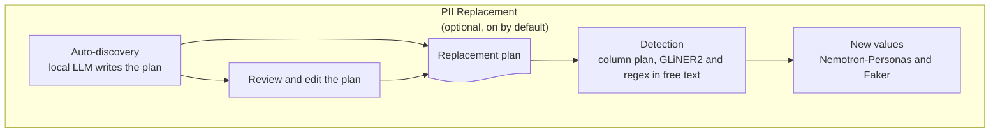

# Review the PII Replacement Plan Before You Train

[The previous note](replacing-identifiers-in-tabular-data-before-training.md) showed personally identifiable information (PII) replacement on a hospital admissions table before NeMo Safe Synthesizer fine-tunes. Detection stays on direct identifiers, and the new values stay consistent across a row and down a column. In this post, we show how you can easily configure the PII replacement step. The replacement plan is one short YAML file. You read it, change the lines that do not match the data, and train with that file.

<!-- more -->

## Where the Plan Comes From

PII replacement still runs as in the previous note. Auto-discovery writes a plan and can pass it straight to replacement. You can optionally review and edit the plan, and run the rest of the pipeline with the reviewed plan. Detection and the new values follow the replacement plan. 



## A Plan Discovery Can Write

The YAML below is an auto-discovered plan for the simulated hospital admissions table in the [review tutorial](../../tutorials/pii-replacement-review.ipynb). Each row is one stay, with the patient's identifiers, the clinical record, and the attending physician, and the plan decides which of those change before training. Note that a discovery rerun can write a slightly different plan.

```yaml
columns_to_replace:
- column_name: patient_id
  entity_type: unique_identifier
- column_name: mrn
  entity_type: unique_identifier
  pattern: MRN-&&&&&&&&&&
- column_name: full_name
  entity_type: full_name
- column_name: attending_physician
  entity_type: full_name
  depends_on:
  - column_name: sex
    entity_type: gender
  - column_name: race_ethnicity
    entity_type: ethnic_background
- column_name: date_of_birth
  entity_type: date_of_birth
  pattern: '%Y-%m-%d'
- column_name: phone
  entity_type: phone_number
  pattern: '###-###-####'
- column_name: email
  entity_type: email
  depends_on:
  - column_name: full_name
    entity_type: full_name
- column_name: address
  entity_type: street_address
- column_name: discharge_summary
  entity_type: free_text
data_to_sampler_value_mapping: {}
```

`columns_to_replace` lists the columns whose values change. Every column left off that list stays as it is. Patient ids, medical record numbers, names, birth dates, phones, emails, street addresses, and the discharge note are on the list. Clinical fields, city, state, postal code, sex, ethnicity, and the ordinary dates are not. Each entry names the column and an `entity_type`, which decides what kind of value is written. An optional `pattern` sets the format. An optional `depends_on` lists other columns in the same row that the new value has to agree with.

`data_to_sampler_value_mapping` translates values in those guiding columns into labels the sampler understands. The last section shows a case that needs one.

Discovery keeps a pattern only when it matches at least 99% of the column's non-null values. If that line is missing, adding it is the whole fix. The `mrn` line is the pattern to check. `&` is a digit or an uppercase letter, and `#` is a digit, so `MRN-&&&&&&&&&&` keeps the `MRN-` prefix and the length. 

## Edit the Plan

Auto-discovery makes a best-effort judgment about which columns directly identify people. Which of those values to protect depends on what you will do with the synthetic data, and NeMo Safe Synthesizer does not know that. In this example, `attending_physician` is personally identifiable, and whether to protect it is a judgment call. If the downstream analysis is the readmission rate per physician, keep that column intact. We make two edits.

Delete the `attending_physician` entry. A column you leave out reaches the model unchanged, so its values can show up in the synthetic data.

Put the `depends_on` lines on `full_name` instead. The starting plan replaces the patient name on its own. With the dependency, the new name is sampled to match the row's sex and ethnicity. That is the match the previous note shows for Quyen Roxas Truong, a southeast Asian woman in the table who becomes Phi Tran.

The rest of the file stays. `email` is still built from the new full name. `address` is still a street address. `discharge_summary` is still `free_text`, so identifiers inside the note change and the clinical sentences stay.

```yaml
columns_to_replace:
- column_name: patient_id
  entity_type: unique_identifier
- column_name: mrn
  entity_type: unique_identifier
  pattern: MRN-&&&&&&&&&&
- column_name: full_name
  entity_type: full_name
  depends_on:
  - column_name: sex
    entity_type: gender
  - column_name: race_ethnicity
    entity_type: ethnic_background
- column_name: date_of_birth
  entity_type: date_of_birth
  pattern: '%Y-%m-%d'
- column_name: phone
  entity_type: phone_number
  pattern: '###-###-####'
- column_name: email
  entity_type: email
  depends_on:
  - column_name: full_name
    entity_type: full_name
- column_name: address
  entity_type: street_address
- column_name: discharge_summary
  entity_type: free_text
data_to_sampler_value_mapping: {}
```

## Train With the File You Reviewed

Point `replacement_plan` at the edited file. The planning model does not run again.

```python
builder = builder.with_replace_pii(replacement_plan="pii_replacement_plan.yaml")
builder.run()
```

## A Few More Controls

- **Value mapping.** `data_to_sampler_value_mapping` is for a guiding column whose values are not labels the sampler already knows. This table does not need one. `Female` and `Male` already match, and every `race_ethnicity` value is already a Nemotron-Personas ethnicity label. A column that uses other words needs an entry. Here `W` maps to `female`, and `Unknown` can draw from either sampler gender.

  ```yaml
  data_to_sampler_value_mapping:
    sex:
      W:
        - female
      Unknown:
        - female
        - male
  ```

- **Inline plan.** Put `columns_to_replace` under `replace_pii.replacement_plan` when you do not want a planning model at all.
- **Where names come from.** Nemotron-Personas supplies names and street addresses when that locale's dataset is installed. Faker fills in the rest, including emails, and it is the fallback when the dataset is missing.
- **Free text.** Only detected spans change. GLiNER2 finds PII in the text, and regex checks catch email addresses, payment card numbers, and IP addresses. With `find_and_replace` on, known values from the same record are also rewritten, as whole words and ignoring case. A value written another way, such as without its prefix or with a different separator, is not matched.
- **Reuse.** Pass the same path on a later run.

[Customizing PII Replacement](../../user-guide/customize-pii-replacement.md) covers entity types, pattern symbols, thresholds, and locales. The [review tutorial](../../tutorials/pii-replacement-review.ipynb) is the runnable version of this workflow.

Have questions or want to share what you are building? Open a [GitHub discussion](https://github.com/NVIDIA-NeMo/Safe-Synthesizer/discussions) or file a [feature request](https://github.com/NVIDIA-NeMo/Safe-Synthesizer/issues).
