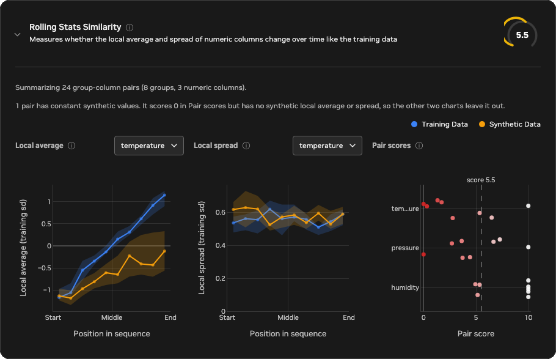

<!-- SPDX-FileCopyrightText: Copyright (c) 2025-2026 NVIDIA CORPORATION & AFFILIATES. All rights reserved. -->
<!-- SPDX-License-Identifier: Apache-2.0 -->

# Rolling Stats Similarity

Rolling Stats Similarity checks whether synthetic numeric columns change from
the start to the end of a sequence the way the training columns do.
Column-level metrics, such as histograms, compare which values appear over the
whole sequence. This metric compares where in the sequence they appear, meaning
how high the values sit and how widely they vary at each point along the way.
It complements [Autocorrelation Similarity](autocorrelation-similarity.md),
which compares how strongly each value resembles the values a few steps
earlier.

The metric tracks two rolling statistics over a short window of consecutive
values. The local average is the rolling mean, which shifts when a temperature
climbs through the day or a pressure steps up when a valve opens. The local
spread is the rolling standard deviation, which measures how widely values vary
around the local average. It grows when a sensor gets noisier as it wears. The
metric averages both statistics over ten segments, each a tenth of the
sequence, and compares the training and synthetic segments in order. A
sequence is one group, such as one sensor, as set by
`data.group_training_examples_by`. Each training group is compared with the
synthetic group of the same label, one numeric column at a time, and each of
these comparisons is a group-column pair.

The figure below shows one training sequence and three synthetic sequences that
all contain exactly the same values, so their histograms are identical. Only
the order differs. The right column shows what the metric compares. It plots
the local average of each segment, with a band of one local spread above and
below it.


- Synthetic A takes a different path but rises and spreads out at the same
  rate. Its local average and spread follow the training data, so it scores
  10.0.
- Synthetic B is the training values shuffled. Every tenth of the sequence then
  holds a random mix of low and high values, so its local average stays flat
  and its local spread stays wide from start to end. It scores 0.4.
- Synthetic C is the training values in reverse order. Its level falls and its
  spread shrinks, the opposite of the training data, so it scores 0.0.

## Reading the score

The score runs from 0 to 10, and higher means the synthetic data's local
average and local spread change over the sequence more like the training
data's. Differences small enough to be explained by chance do not lower the
score. When the training data's changes are tied to position in the sequence,
such as a trend, a scheduled step, or a seasonal level, synthetic data from the
same process scores highly. Synthetic data that misses or reverses a trend, a
step, or a change in volatility scores near 0. If the training data's level and
spread stay flat, synthetic data that also stays flat matches it. Two such
series average about 7.6, because with nothing to match, the chance
differences of a single pair sometimes exceed what the noise model predicts.

The metric matches the first tenth of the training sequence with the first
tenth of the synthetic sequence, and so on. A change that happens at the wrong
time lowers the score, just as a missing change does. Both series are measured
in training standard deviations from the training mean, so the score also
counts differences in overall level and scale, which Autocorrelation Similarity
ignores.

Changes that happen at random times lower the score even for synthetic data
from the same process. A random walk, a level that switches between regimes at
random points, or volatility that clusters at random times puts its changes in
different segments in every sequence. The training and synthetic segments then
disagree by more than chance would explain. For data like this, also check
Autocorrelation Similarity, which does not depend on when changes happen.

With about 200 points per sequence, scores fall into rough tiers, taken from
the [example scenarios](#example-scenarios):

- About 8 to 10 means the synthetic data keeps the training data's local
  average and spread over time, as with the same process (about 9) or the same
  level step (about 9.4).
- About 5 to 8 means the synthetic data has the right shape but is somewhat off
  in size or timing, as with a trend two-thirds as strong (about 7.5) or a
  level offset of half a standard deviation (about 6.1).
- About 2 to 5 means the synthetic data loses a large part of the training
  data's behavior, as with a spread half as large (about 2.6) or shuffled
  values (about 2.6). Same-process data whose changes happen at random times
  also lands here, as with the same random walk (about 4.1) or the same
  volatility clusters (about 3.7).
- About 0 to 2 means the synthetic data has lost or reversed the training
  data's changes over time, as when a trend or a level step is missing or the
  sequence runs backward.
- A pair also scores 0 when its synthetic values are constant or mostly
  missing while the training values vary.

Longer sequences measure each segment more precisely, so a real difference
stands out more clearly and scores lower. Shorter sequences carry less
evidence, so the metric gives them more benefit of the doubt and their scores
bunch toward the middle. Synthetic data from the same process scores highly at
any length when the training data's changes are tied to position. When changes
happen at random times, same-process scores fall as sequences get longer.

Use these tiers as a guide. Whether a difference matters depends on the use
case. Reproducing a steady rise may be critical for forecasting or capacity
planning, while a workload that uses only overall totals might not depend on
it.

The score covers only how the local average and spread change along the
sequence. The values themselves, their distributions, and the relationships
between columns can still match well when the score is low, as with the
shuffled and reversed series in the figure above, which have exactly the
training values. Read it alongside the Synthetic Quality Score and
Autocorrelation Similarity. Compare scores across runs only when the columns,
groups, and `window_size` are the same.

### Reading the report charts

The card is in the Time-Series Metrics panel of the Synthetic Quality section
of the HTML evaluation report. Expand it to see three charts built from every
evaluated group-column pair, and select the info icon next to a chart title for
a short reminder of how to read it.



The example above comes from a dataset of eight sensors, grouped by sensor ID,
with three numeric columns. In the training data, `temperature` rises steadily,
`pressure` steps up 60% of the way through, and `humidity` spreads out over
time. The synthetic data reproduces sensor 0 closely and loses a little more of
that structure with each sensor after it, showing a weaker temperature trend, a
later and smaller pressure step, and a humidity spread that stops growing.
Sensor 7 also has a constant `pressure` series.

The note above the charts lists any pair whose synthetic values are constant or
mostly missing. Such a pair scores 0 but has no synthetic local average or
spread, so only Pair scores shows it. Here, the note reports the constant
`pressure` series of sensor 7, and the other two charts use the remaining
pairs.

- Average and spread
  - This chart shows the median training and synthetic local average in the
    top panel and local spread in the bottom panel, in each tenth of the
    sequence, for one numeric column. The local average is in training
    standard deviations from the training mean, and the local spread is in
    training standard deviations. The shaded bands cover the middle 50% of
    groups. The chart opens on the column with the lowest mean pair score. Use
    the column selector next to the title to switch columns. In good synthetic
    data, the blue and orange lines overlap. Medians can cancel when groups
    change in opposite directions, for example if half the sensors rise and
    half fall. Difference by segment covers that case.
  - In this example, the chart opens on `temperature`. The training median
    local average rises from about -1.2 at the start to about 1.2 at the end,
    while the synthetic median rises only to about -0.1, so most synthetic
    sensors lost part of the trend. Both spread lines stay between about 0.5
    and 0.65, so the spread is reproduced. Switch to `pressure` to see the
    training step a little past the middle and the synthetic step arriving
    later, or to `humidity` to see the training spread grow from about 0.6 to
    about 1.3 while the synthetic median ends near 1.05.
- Difference by segment
  - This chart shows the mean absolute difference between the training and
    synthetic local average (solid bars) and local spread (hatched bars) in
    each tenth of the sequence, across all group-column pairs. The difference
    is taken within each pair before averaging, so groups that change in
    opposite directions cannot cancel. Hover over a bar to see its exact value
    and how many pairs it averages. The y-axis always spans at least 0 to 1
    training standard deviation, so short, pale bars mean small differences,
    and bars turn red as the difference approaches 1. Bars that grow toward the
    end point to a missing or weaker trend, and a jump at one segment points to
    a missing or shifted step.
  - In this example, the local average difference stays between about 0.25 and
    0.35 in the first half, then rises to about 0.6 to 0.8 from 60% of the way
    through, where the pressure step and most of the temperature trend fall.
    The local spread difference stays between about 0.1 and 0.17 throughout,
    so most of the mismatch is in the level.
- Pair scores
  - This chart shows the score of every group-column pair on the 0–10 scale,
    with the overall score marked by the dashed line. Each point is one group,
    shaded from white at 10 to red at 0, and each row is one column. Points
    within a row are spread out vertically so that equal scores stay visible.
    Hover over a point to see its full column name, group, and score. The chart
    shows the 8 lowest-scoring columns. Column names longer than 10 characters
    are shortened to their first and last three characters, as with
    `tem...ure`.
  - In this example, each point is one sensor. `temperature` scores fall from
    10 for sensor 0 to near 0 for the last sensors, and `pressure` scores fall
    more gradually, to 0 for the constant sensor 7 series. `humidity` scores 10
    for sensors 0 to 4 and about 5 for sensors 5 to 7, whose spread stopped
    growing. The gap between the overall score of 5.5 and 10 therefore comes
    mostly from `temperature` and `pressure`.

### When the score is available

The score needs:

- Time-series mode, set by `time_series.is_timeseries`.
- At least one numeric column in both the training and synthetic data.
- At least one group in both datasets, matched by label. Without
  `data.group_training_examples_by`, the whole dataset is one sequence.
- At least one group-column pair whose training series varies, has at least
  `min_points` finite values, and has a segment with enough values.

A training series that is constant or too sparse to measure has no local level
or spread to compare, so the metric skips that pair. The metric also skips a
pair when the synthetic series has values only in segments where the training
series has none. When no pair is usable, the score is unavailable.

## Example scenarios

The figures below show how the metric scores one group-column pair in a range
of situations, ordered from the highest average score to the lowest. Each row
compares one training series (blue) with one synthetic series (orange):

- The left chart shows the values.
- The two middle charts show the local average and the local spread in each of
  the ten segments, from the start of the sequence to the end, in training
  standard deviations. The shaded band around the training line is the
  difference that chance alone would produce.
- The right column shows the average score across 200 random pairs from the
  same scenario, with 200 points per sequence. The plotted pair is one of
  them, and a single pair can land a point or more away from the average.


## Configuration

Time-series evaluation runs by default whenever `time_series.is_timeseries` is
true. It computes the metric and adds it to the Time-Series Metrics panel in the
Synthetic Quality section of the HTML evaluation report. Set
`evaluation.time_series.enabled: false` to skip all time-series metrics.
Setting it to `true` without time-series mode is a configuration error.

```yaml
time_series:
  is_timeseries: true
  timestamp_column: time
evaluation:
  time_series:
    enabled: null  # null follows time_series.is_timeseries
    rolling_stats:
      value_columns: null
      window_size: 20
      min_points: 4
      max_groups: 128
```

Values are ordered by `time_series.timestamp_column` and split into sequences by
`data.group_training_examples_by`.

- Leave `value_columns` as `null` to evaluate every column that both datasets
  share and that is inferred as numeric. Set an explicit list to evaluate only
  selected numeric columns.
- Set `window_size` to the number of consecutive values that count as local.
  Variation faster than the window counts as local spread, and slower
  variation counts as a change in the local average. Choose a window longer
  than the short-term fluctuations you treat as noise and shorter than the
  changes in level you want compared. The ten fixed segments set how finely
  the score locates a change in time. When either sequence has fewer than
  twice `window_size` finite values, the window is half the smaller finite
  count, with a minimum of 3.
- Raise `min_points` to require more finite values per series. Training series
  with fewer are skipped, and synthetic series with fewer score 0.
- Lower `max_groups` to evaluate fewer groups. When more groups are shared, the
  metric evaluates a reproducible random sample of them and reports the total,
  evaluated, and omitted shared-group counts.

## Limitations

- The metric compares ten segments by their position in the sequence, so it
  assumes that the training and synthetic sequences of a group cover
  comparable stretches of time.
- It cannot tell whether a change is random or tied to a time. Changes at
  random times score low even for synthetic data from the same process, and
  matching volatility clusters score about as low as lost ones.
- A spread pattern that the synthetic data loses while keeping the level
  scores about 7.4, a mild loss, because the local average still matches.
- Patterns shorter than the window, such as step-to-step persistence and
  cycles, are averaged away.
  [Autocorrelation Similarity](autocorrelation-similarity.md) measures them.
- The score compares segment summaries, so individual events and values can
  differ even when it is high.
- Binary and categorical columns need different measures and are not selected
  automatically.
- The metric does not measure causality or whether the synthetic data
  memorizes training sequences.
- The score combines all segments, both statistics, all columns, and all
  groups in one number. The report charts show which columns and groups drive
  it.

## Calculation

For every usable group and numeric column, the metric standardizes both
sequences with the training mean and standard deviation. With window \(w\),
it computes two rolling statistics over complete windows:

- The local average is the mean of the \(w\) values in each window.
- The local spread is the root mean square, over each window, of every value's
  deviation from the centered rolling mean around it. This is close to the
  rolling standard deviation, and it lets the chance-noise estimate below use
  the same quantities as the statistic.

Each rolling statistic is then averaged over ten equal segments by relative
position, from the start of the sequence to the end, giving training values
\(T_j\) and synthetic values \(S_j\) for each statistic and segment \(j\). The
metric compares them in three steps:

1. Estimate how much a segment value varies by chance. Each segment value is a
   weighted average of the underlying values, so its variance follows from the
   series' autocovariance. The metric removes a straight-line trend from each
   series, so a steady trend does not inflate the chance estimate, and fits a
   first-order autoregressive model with standard small-sample corrections,
   which gives smooth autocovariances even for short sequences. The local
   spread uses the same model on the squared deviations, converted with
   \(\operatorname{Var}(s) \approx \operatorname{Var}(s^2) / (4\,\mathrm{E}[s^2])\).
   The noise allowance \(\sigma^2\) for each statistic adds the training and
   synthetic variances.
2. Weight each statistic by \(1 / \sigma^2\), sum the squared gaps between the
   segment values, and subtract the squared gap that chance alone would
   produce, \(\sigma^2\) per segment. What remains is the excess difference,
   floored at 0.
3. Compare the excess with the structure present in each segment,
   \(m_j = \max(|T_j - r|, |S_j - r|)\), where the reference \(r\) is the
   training mean for the local average and the training's average local spread
   for the local spread. Using the larger of the two penalizes lost structure
   and invented structure alike:

\[
\text{pair similarity} = 1 - \sqrt{\frac{\max\left(0, \sum \frac{1}{\sigma^2} \left[(T_j - S_j)^2 - \sigma^2\right]\right)}{\sum \frac{1}{\sigma^2} \max(m_j^2, \sigma^2)}}
\]

where both sums run over the ten segments of both statistics. Subtracting the
expected chance difference before taking the square root means that two
sequences from the same process do not lose points on average, and pooling the
segments before the square root keeps several small chance gaps from adding up
to a large penalty. The result is clipped to the range 0 to 1. The final 0–10
score is ten times the mean pair similarity across group-column pairs.
Therefore, 10 means the local average and spread agree within chance, and 0
means none of the training data's changes over the sequence are reproduced.

Missing and non-finite values stay as gaps in their original positions, and a
window counts only when at least half of its values are present. Very short
sequences use fewer than ten segments. A comparison is skipped when the
training series is constant, has fewer than `min_points` finite values, or has
no segment with enough values, because it has no local level or spread to
compare. It is also skipped when no segment has values in both series. If the
training series varies but the synthetic series is constant or mostly missing,
with fewer than `min_points` finite values or no window with enough of them,
that comparison scores 0 to represent complete loss of variation over time.
