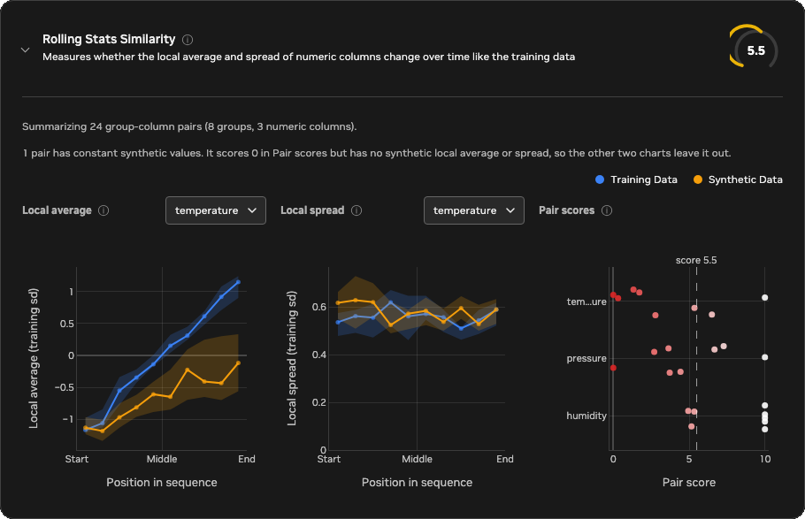

<!-- SPDX-FileCopyrightText: Copyright (c) 2025-2026 NVIDIA CORPORATION & AFFILIATES. All rights reserved. -->
<!-- SPDX-License-Identifier: Apache-2.0 -->

# Rolling Stats Similarity

Rolling Stats Similarity checks whether synthetic numeric columns change from
the start to the end of a sequence the way the training columns do.
Column-level metrics, such as histograms, compare which values appear over the
whole sequence. This metric compares where in the sequence they appear: how
high the values sit and how widely they vary at each point along the way.

Two properties matter most:

- Local level, measured by the rolling mean: the average of the nearby values.
  A temperature that climbs steadily through the day, or a pressure that steps
  up when a valve opens, changes its local level.
- Volatility, measured by the rolling standard deviation: how widely values
  vary around their local level. A sensor that gets noisier as it wears, or a
  process that turns turbulent after a change, changes its volatility.

The report and this guide call these two rolling statistics the local average
and the local spread. "The score" means the 0–10 Rolling Stats Similarity
score.

The figure below shows one training sequence and three synthetic sequences that
all contain exactly the same values, so their histograms are identical. Only
the order differs. The right column shows what the metric compares: the local
average of each tenth of the sequence, with a band of one local spread above
and below it.


- Synthetic A takes a different path but rises and spreads out at the same
  rate. Its local average and spread follow the training data, so it scores
  10.0.
- Synthetic B is the training values shuffled. Every tenth of the sequence then
  holds a random mix of low and high values, so its local average stays flat
  and its local spread stays wide from start to end. It scores 0.4.
- Synthetic C is the training values in reverse order. Its level falls and its
  spread shrinks, the opposite of the training data, so it scores 0.0.

## Reading the score

A higher score means the synthetic data's local average and local spread change
over the sequence more like the training data's. Differences small enough to be
explained by chance do not lower the score, so synthetic data generated by the
same process as the training data scores highly. When the training data has a
trend, a step, or a change in volatility, synthetic data without that change, or
with it reversed, scores near 0. If the training data has none of these changes,
for example if its level and spread stay flat, synthetic data that also stays
flat matches it and scores high.

The metric compares sequences by position: the first tenth of the training
sequence with the first tenth of the synthetic sequence, and so on. A change
that happens at the wrong time therefore lowers the score as well as a change
that is missing. Unlike Autocorrelation Similarity, the score also counts
differences in overall level and scale, because both series are measured in
training standard deviations from the training mean.

The score covers only how the local average and spread change along the
sequence. A low score means the synthetic data does not reproduce the
trends, steps, or volatility changes of the training data. The values
themselves, their distributions, and the relationships between columns can
still match well, as with the shuffled and reversed series in the figure above,
which have exactly the training values. Read this score alongside the Synthetic
Quality Score, and weigh it by how much your use case depends on how values
change over the course of a sequence.

### Example scenarios

The figures below show how the metric scores one group-column pair in a range
of situations, ordered from the highest average score to the lowest. Each row
compares one training series (blue) with one synthetic series (orange):

- The left chart shows the values.
- The two middle charts show the local average and the local spread in each of
  the ten segments, from the start of the sequence to the end, in training
  standard deviations. The shaded band around the training line is the
  difference that chance alone would produce.
- The right column shows the average score across 200 random pairs from the
  same scenario, with 200 points per sequence. The plotted pair is one of
  them, and a single pair can land a point or more away from the average.


With about 200 points per sequence, scores fall into rough tiers:

- About 8 to 10: the synthetic data keeps the training data's local average
  and spread over time, for example the same process (about 9), the same level
  step (about 9.4), or the same process with missing values (about 8.4). Two
  series with no structure average about 7.6, because with nothing to match, a
  single pair's chance differences sometimes exceed what the noise model
  predicts.
- About 5 to 8: the synthetic data has the right shape but is somewhat off in
  size or timing, for example a trend two-thirds as strong (about 7.5), a step
  that comes a little late (about 7.4), outlier spikes (about 7.7), a level
  offset of half a standard deviation (about 6.1), or a spread 25% too large
  (about 6.6). Losing a pattern in the spread while the level still matches
  also lands here (about 7.4).
- About 2 to 5: the synthetic data loses a large part of the training data's
  behavior, for example a spread half as large (about 2.6), or shuffled values
  (about 2.6).
- About 0 to 2: the synthetic data has lost or reversed the training data's
  changes over time, as when a trend or a level step is missing, or the
  sequence runs backward.
- 0: the synthetic values are constant while the training values vary. If the
  training values are constant, there is no local level or spread to compare,
  so the metric skips that group-column pair instead of scoring it.

Sequence length affects how much the score can tell apart. Longer sequences
measure each segment's local average and spread more precisely, so a real
difference stands out more clearly and scores lower. Shorter sequences carry
less evidence, so the metric gives them more benefit of the doubt and their
scores bunch toward the middle. Synthetic data from the same process scores
highly at any length.

These tiers are a guide rather than pass or fail thresholds. Within one report,
every group-column pair uses the same columns, groups, and `window_size`. When
you compare scores across runs, check that those settings and the input data's
columns and groups are the same, because changing them changes what the score
measures. Whether a difference matters depends on the downstream use case. For
example, reproducing a steady rise may be critical for forecasting or capacity
planning, while a workload that uses only overall totals might not depend on
it.

### Reading the report charts

The Rolling Stats Similarity card is in the automatically generated HTML
quality and privacy report. Select Synthetic Quality in the report's navigation
and find the card in the Time-Series Metrics panel, then expand it to see three
charts built from every evaluated group-column pair. Select the info icon next
to a chart title for a short reminder of how to read it.



The example above comes from a dataset of eight sensors, grouped by sensor ID,
with three numeric columns. In the training data, `temperature` rises steadily,
`pressure` steps up 60% of the way through, and `humidity` spreads out over
time. The synthetic data reproduces sensor 0 closely and loses a little more of
that structure with each sensor after it: a weaker temperature trend, a later
and smaller pressure step, and a humidity spread that stops growing. Sensor 7
also has a constant `pressure` series. You can confirm each of these details in
the report itself: use the column selectors on the first two charts, and hover
over any point to see its exact values.

- Local average
  - What it shows: the median training and synthetic local average in each
    tenth of the sequence for one numeric column, in training standard
    deviations from the training mean. The shaded bands cover the middle 50%
    of groups. The chart opens on the column with the lowest mean pair score.
    Use the column selector next to the title to switch columns. In good
    synthetic data, the blue and orange lines overlap.
  - In this example: the chart opens on `temperature`. The training median
    rises from about -1.2 at the start to about 1.2 at the end, while the
    synthetic median rises only to about -0.1, so most synthetic sensors lost
    part of the trend. Switch to `pressure` to see the training step a little
    past the middle and the synthetic step arriving later.
- Local spread
  - What it shows: the median training and synthetic local spread in each
    tenth of the sequence for one numeric column, in training standard
    deviations, with the same bands and column selector as Local average. In
    good synthetic data, the lines overlap.
  - In this example: for `temperature`, both lines stay between about 0.5 and
    0.65, so the spread is reproduced and the low score comes from the local
    average. Switch to `humidity` to see the training spread grow from about
    0.6 to about 1.3 while the synthetic median ends near 1.05.
- Pair scores
  - What it shows: the score of every group-column pair on the 0–10 scale,
    with the overall score marked by the dashed line. Each point is one group,
    shaded from white at 10 to red at 0, and each row is one column. Points
    within a row are spread out vertically so that equal scores stay visible.
    Hover over a point to see its full column name, group, and score. The chart
    shows the 8 lowest-scoring columns. Column names longer than 10 characters
    are shortened to their first and last three characters, as with
    `tem...ure`.
  - In this example: each point is one sensor. `temperature` scores fall from
    10 for sensor 0 to near 0 for the last sensors, and `pressure` scores fall
    more gradually, to 0 for the constant sensor 7 series. `humidity` scores 10
    for sensors 0 to 4 and about 5 for sensors 5 to 7, whose spread stopped
    growing. The gap between the overall score of 5.5 and 10 therefore comes
    mostly from `temperature` and `pressure`.

A pair whose synthetic values are constant scores 0 but has no synthetic local
average or spread, so only Pair scores shows it. In the example, the `pressure`
point at 0 is sensor 7, and the note above the charts reports it. The Local
average and Local spread medians for `pressure` use the remaining seven
sensors.

## Configuration

Time-series evaluation runs by default whenever `time_series.is_timeseries` is
true. It computes the metric and adds it to the Time-Series Metrics panel in the
Synthetic Quality section of the HTML evaluation report. Set
`evaluation.time_series.enabled: false` to skip all time-series metrics.
Setting it to `true` without time-series mode is a configuration error.

```yaml
time_series:
  is_timeseries: true
  timestamp_column: time
evaluation:
  time_series:
    enabled: null  # null follows time_series.is_timeseries
    rolling_stats:
      value_columns: null
      window_size: 20
      min_points: 4
      max_groups: 128
```

`value_columns: null` evaluates every column that both datasets share and that
is inferred as numeric. Set an explicit list to evaluate only selected numeric
columns. Values are ordered by `time_series.timestamp_column` and split into
sequences by `data.group_training_examples_by`.

`window_size` sets how many consecutive values count as local. Use a window
that matches the timescale of the changes your use case depends on: a larger
window smooths over short bursts, and a smaller one reacts to them. Sequences
shorter than twice the window use a window of half their length.

If more than `max_groups` groups are shared, the metric evaluates a reproducible
random sample of groups instead of the ones whose labels sort first. The result
reports the total, evaluated, and omitted shared-group counts. Changing
`value_columns`, `window_size`, or the grouping configuration changes what the
aggregate score measures.

## Limitations

The metric compares ten segments by their position in the sequence, so it
assumes that the training and synthetic sequences of a group cover comparable
stretches of time. It cannot tell whether a change is random or tied to a time.
When calm and turbulent stretches occur at random times, two sequences from the
same process put them in different segments, so the metric scores them as
mismatched. In the additional scenarios, matching volatility clusters (about
3.7) score about the same as volatility clusters that the synthetic data lost
(about 3.9). A spread pattern that the synthetic data loses while keeping the
level also scores only as a mild loss (about 7.4), because the local average
still matches.

The local average and spread summarize each segment, so they cannot see
patterns shorter than the window, such as the step-to-step persistence and
cycles that
[Autocorrelation Similarity](autocorrelation-similarity.md) measures. A high
score does not mean that individual events or values match. Binary and
categorical columns need different measures and are not selected
automatically. The metric does not establish causality or show whether the
synthetic data memorizes training sequences. The score summarizes all segments,
both statistics, all columns, and all groups in one number, so it can't tell
you about a particular part of the sequence. To judge whether the synthetic
data preserves the behavior your use case needs, look at the detailed report
charts for the columns and groups that matter to you.

## Calculation

For every usable group and numeric column, the metric standardizes both
sequences with the training mean and standard deviation. With window \(w\),
it computes two rolling statistics over complete windows:

- The local average: the mean of the \(w\) values in each window.
- The local spread: the root mean square, over each window, of every value's
  deviation from the centered rolling mean around it. This is close to the
  rolling standard deviation, and it lets the chance-noise estimate below use
  the same quantities as the statistic.

Each rolling statistic is then averaged over ten equal segments by relative
position, from the start of the sequence to the end, giving training values
\(T_j\) and synthetic values \(S_j\) for each statistic and segment \(j\). The
metric compares them in three steps:

1. Estimate how much a segment value varies by chance. Each segment value is a
   weighted average of the underlying values, so its variance follows from the
   series' autocovariance. The metric removes a straight-line trend from each
   series, so a steady trend counts as structure rather than chance, and fits a
   first-order autoregressive model with standard small-sample corrections,
   which gives smooth autocovariances even for short sequences. The local
   spread uses the same model on the squared deviations, converted with
   \(\operatorname{Var}(s) \approx \operatorname{Var}(s^2) / (4\,\mathrm{E}[s^2])\).
   The noise allowance \(\sigma^2\) for each statistic adds the training and
   synthetic variances.
2. Weight each statistic by \(1 / \sigma^2\), sum the squared gaps between the
   segment values, and subtract the squared gap that chance alone would
   produce, \(\sigma^2\) per segment. What remains is the excess difference,
   floored at 0.
3. Compare the excess with the structure present in each segment,
   \(m_j = \max(|T_j - r|, |S_j - r|)\), where the reference \(r\) is the
   training mean for the local average and the training's average local spread
   for the local spread. Using the larger of the two penalizes lost structure
   and invented structure alike:

\[
\text{pair similarity} = 1 - \sqrt{\frac{\max\left(0, \sum \frac{1}{\sigma^2} \left[(T_j - S_j)^2 - \sigma^2\right]\right)}{\sum \frac{1}{\sigma^2} \max(m_j^2, \sigma^2)}}
\]

where both sums run over the ten segments of both statistics. Subtracting the
expected chance difference before taking the square root means that two
sequences from the same process do not lose points on average, and pooling the
segments before the square root keeps several small chance gaps from adding up
to a large penalty. The result is clipped to the range 0 to 1. The final 0–10
score is ten times the mean pair similarity across group-column pairs.
Therefore, 10 means the local average and spread agree within chance, and 0
means none of the training data's changes over the sequence are reproduced.

Missing and non-finite values stay as gaps in their original positions, and a
window counts only when at least half of its values are present. Sequences
shorter than twice `window_size` use a window of half their length, and very
short sequences use fewer than ten segments. A comparison is skipped when the
training series is constant, because it has no local level or spread to
compare. If the training series varies but the synthetic series is constant,
that comparison scores 0 to represent complete loss of variation over time.
