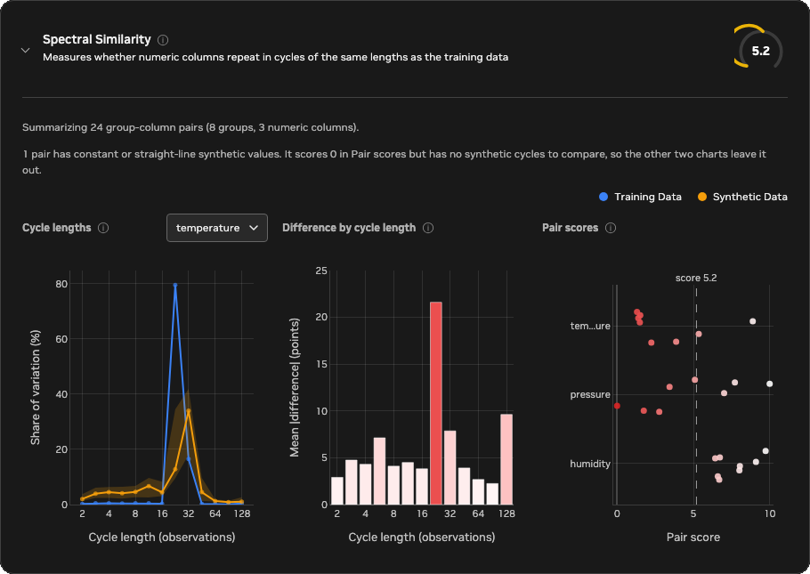

<!-- SPDX-FileCopyrightText: Copyright (c) 2025-2026 NVIDIA CORPORATION & AFFILIATES. All rights reserved. -->
<!-- SPDX-License-Identifier: Apache-2.0 -->

# Spectral Similarity

Spectral Similarity checks whether synthetic numeric columns repeat in cycles
of the same lengths as the training columns. Column-level metrics, such as
histograms, compare which values appear. This metric compares how the values
rise and fall over time, broken down by how long each rise and fall takes.

Three properties matter most:

- Periodicity: whether values rise and fall in a repeating cycle, and how long
  one cycle takes, called the period or cycle length. Hourly temperature with a
  daily pattern has a 24-step cycle, and daily sales with a weekly pattern have
  a 7-step cycle.
- Cycle strength: how much of a column's variation a cycle holds compared with
  the rest. A strong daily pattern with little noise holds most of the
  variation, and the same pattern buried in noise holds only a little.
- Smoothness: whether the rest of the variation comes from slow drifts or from
  fast changes between neighboring values.

All three come from the power spectrum, which splits a sequence's variation
into cycles of every length and measures the share each length holds. This
guide calls that breakdown the spectrum and groups cycle lengths into bands.
"The score" means the 0–10 Spectral Similarity score.

The figure below shows one training sequence and three synthetic sequences that
all contain exactly the same values, so their histograms are identical. Only
the order differs. The right column shows what the metric compares: the share
of variation in each cycle-length band.


- Synthetic A takes a different path with the same 24-step cycle. Its variation
  sits at the same cycle length as the training data's, so it scores 10.0.
- Synthetic B is the training values shuffled. Shuffling removes the cycle, so
  the variation spreads out and lands mostly in the shortest cycles, the way
  structureless noise does. It scores 0.6.
- Synthetic C arranges the same values into a 12-step cycle. Its variation sits
  in a band an octave away from the training data's, so it scores 0.4.

## Reading the score

A higher score means the synthetic data spreads its variation across cycle
lengths more like the training data does. Differences small enough to be
explained by chance do not lower the score, so synthetic data generated by the
same process as the training data scores highly. When the training data has a
cycle, synthetic data without it scores low, and synthetic data with a cycle of
the wrong length scores near 0. If the training data has no cycle and no particular smoothness, for
example if it is structureless noise, synthetic data that is also structureless
noise matches it and scores high.

The score ignores level, scale, and a straight-line trend, because the metric
removes the trend and compares shares of variation rather than amounts.
[Rolling Stats Similarity](rolling-stats-similarity.md) measures those. It also
ignores when in its cycle a series peaks: a daily pattern that peaks at noon
and one that peaks at midnight look the same.

The score covers only how variation is spread across cycle lengths. A low score
means the synthetic data does not reproduce the training data's cycles or
smoothness. The values themselves, their distributions, and the relationships
between columns can still match well, as with the shuffled and rearranged
series in the figure above, which have exactly the training values. Read this
score alongside the Synthetic Quality Score, and weigh it by how much your use
case depends on repeating cycles.

### Example scenarios

The figures below show how the metric scores one group-column pair in a range
of situations, ordered from the highest average score to the lowest. Each row
compares one training series (blue) with one synthetic series (orange):

- The left chart shows the first 100 values.
- The middle chart shows the share of variation in each cycle-length band, from
  the shortest cycles of 2 steps on the left to cycles of 128 steps on the
  right. A peak marks a repeating cycle. The shaded band around the training
  line is the difference that chance alone would produce.
- The right column shows the average score across 200 random pairs from the
  same scenario, with 200 points per sequence. The plotted pair is one of
  them, and a single pair can land a point or more away from the average.

Structureless noise puts most of its variation in the shortest cycles, because
the shorter bands cover more distinct cycle lengths. A flat-looking series
therefore shows a line that mostly falls from left to right.


With about 200 points per sequence, scores fall into rough tiers:

- About 8 to 10: the synthetic data keeps the training data's cycles and
  smoothness, for example the same process (about 10), the same two cycles
  (about 10), pure noise against pure noise (about 9.6), the same process with
  missing values (about 9.6), or the same slow-moving process without a cycle
  (about 8.8). Differences too small to detect at this length also land here:
  a 26-step cycle in place of a 24-step one (about 9.7), an extra, weaker
  7-step cycle (about 8.7), or a slightly less persistent process (about 8.2).
- About 5 to 8: the synthetic data keeps the main cycle but loses or adds part
  of the variation around it, for example a lost second cycle (about 7.5), a
  cycle that stops halfway through (about 6.9), or outlier spikes (about 6.2).
- About 2 to 5: the synthetic data loses a large part of the structure, for
  example a cycle buried in three times the noise (about 4.9), a much less
  persistent process (about 4.7), an overly smooth process (about 3.8), a
  48-step cycle replaced by a 36-step one (about 3.2), or a missing cycle
  (about 2.6).
- About 0 to 2: the synthetic data has lost the cycle or has one of the wrong
  length, as with shuffled values (about 1.4) or a cycle half as long (about
  1.0).
- 0: the synthetic values are constant, or follow a straight line, while the
  training values vary. If the training values are constant or follow a
  straight line, there is no spectrum to compare, so the metric skips that
  group-column pair instead of scoring it.

Sequence length affects how much the score can tell apart. Longer sequences
measure the spectrum more finely, so cycles of similar length separate: a
26-step cycle in place of a 24-step one scores about 9.7 at 200 points and
about 6.9 at 1,000. Shorter sequences carry less evidence, so the metric gives
them more benefit of the doubt and their scores bunch toward the middle. With
about 30 points per sequence, a missing cycle still scores about 6. A sequence
also cannot show cycles longer than itself. Synthetic data from the same
process scores highly at any length.

These tiers are a guide rather than pass or fail thresholds. Within one report,
every group-column pair uses the same columns, groups, and `max_cycle_length`.
When you compare scores across runs, check that those settings and the input
data's columns and groups are the same, because changing them changes what the
score measures. Whether a difference matters depends on the downstream use
case. For example, reproducing a daily cycle may be critical for demand
forecasting or staffing, while a workload that uses only daily totals might
not depend on it.

### Reading the report charts

The Spectral Similarity card is in the automatically generated HTML quality and
privacy report. Select Synthetic Quality in the report's navigation and find
the card in the Time-Series Metrics panel, then expand it to see three charts
built from every evaluated group-column pair. Select the info icon next to a
chart title for a short reminder of how to read it.



The example above comes from a dataset of eight sensors with hourly readings,
grouped by sensor ID, with three numeric columns. In the training data,
`temperature` has a daily cycle, `humidity` has a daily cycle and a weaker
6-hour cycle, and `pressure` drifts slowly. The synthetic data reproduces
sensor 0 closely and loses a little more of that structure with each sensor
after it: a temperature cycle that stretches and weakens, a 6-hour humidity
cycle that fades, and pressure that drifts less. Sensor 7 also has a constant
`pressure` series. You can confirm each of these details in the report itself:
use the column selector on the first chart, and hover over any point or bar to
see its exact values.

Each band is labeled by the cycle length at its center, in observations. A band
covers cycles from the band on its left to the band on its right, so the band
labeled 23 covers cycles of about 16 to 32 observations.

- Cycle lengths
  - What it shows: for one numeric column, the median training and synthetic
    share of variation in each cycle-length band, from short cycles on the left
    to long cycles on the right. The shaded bands cover the middle 50% of
    groups. The chart opens on the column with the lowest mean pair score. Use
    the column selector next to the title to switch columns. In good synthetic
    data, the blue and orange lines overlap, with peaks at the same cycle
    lengths and of the same height. Medians can blur when groups have cycles of
    different lengths, so overlapping lines do not guarantee that each group
    matches. Difference by cycle length covers that case.
  - In this example: the chart opens on `temperature`. The training median
    puts about 80% of the variation in the band labeled 23, the daily cycle.
    The synthetic median puts only about 13% there and about 34% in the band
    labeled 32, because most synthetic sensors stretched the cycle, and it
    spreads about 2% to 7% into each of the shorter bands, where the extra
    noise lands. Switch to `humidity` to see the 6-hour cycle hold about 22% of the
    training variation but only about 9% of the synthetic variation, or to
    `pressure` to see the training put about 40% of its variation in the
    longest band, the slow drift, while the synthetic spreads it evenly.
- Difference by cycle length
  - What it shows: the mean absolute difference between the training and
    synthetic share of variation in each band, in percentage points, across all
    group-column pairs. Each pair is compared with itself before averaging, so
    groups with cycles of different lengths cannot cancel. Hover over a bar to
    see its exact value and how many pairs it averages. The y-axis always spans
    at least 0 to 25 points, so short, pale bars mean small differences, and
    bars turn red as the difference approaches 25. A tall bar marks a cycle
    length that the synthetic data has too much or too little of.
  - In this example: the tallest bar, about 22 points, is the band labeled 23,
    where the synthetic temperature lost most of its daily cycle. The band
    labeled 128 follows at about 10 points, from the pressure drift, and the
    band labeled 6 at about 7 points, from the fading 6-hour humidity cycle.
    The other bands stay between about 2 and 8 points.
- Pair scores
  - What it shows: the score of every group-column pair on the 0–10 scale,
    with the overall score marked by the dashed line. Each point is one group,
    shaded from white at 10 to red at 0, and each row is one column. Points
    within a row are spread out vertically so that equal scores stay visible.
    Hover over a point to see its full column name, group, and score. The chart
    shows the 8 lowest-scoring columns. Column names longer than 10 characters
    are shortened to their first and last three characters, as with
    `tem...ure`.
  - In this example: each point is one sensor. `temperature` scores fall from
    about 8.9 for sensor 0 to between 1.3 and 1.5 for sensors 4 to 7.
    `humidity` scores fall more gently, from about 9.7 to about 6.4.
    `pressure` scores vary more from sensor to sensor, between about 1.7 and
    10, and sensor 7, the constant series, scores 0. The gap between the
    overall score of 5.2 and 10 therefore comes mostly from `temperature` and
    `pressure`.

A pair whose synthetic values are constant scores 0 but has no synthetic
spectrum, so only Pair scores shows it. In the example, the `pressure` point at
0 is sensor 7, and the note above the charts reports it. The Cycle lengths
medians for `pressure` and the Difference by cycle length bars use the
remaining pairs.

## Configuration

Time-series evaluation runs by default whenever `time_series.is_timeseries` is
true. It computes the metric and adds it to the Time-Series Metrics panel in the
Synthetic Quality section of the HTML evaluation report. Set
`evaluation.time_series.enabled: false` to skip all time-series metrics.
Setting it to `true` without time-series mode is a configuration error.

```yaml
time_series:
  is_timeseries: true
  timestamp_column: time
evaluation:
  time_series:
    enabled: null  # null follows time_series.is_timeseries
    spectral:
      value_columns: null
      max_cycle_length: 128
      min_points: 16
      max_groups: 128
```

`value_columns: null` evaluates every column that both datasets share and that
is inferred as numeric. Set an explicit list to evaluate only selected numeric
columns. Values are ordered by `time_series.timestamp_column` and split into
sequences by `data.group_training_examples_by`.

`max_cycle_length` sets the longest cycle, in observations, that the score
tells apart from slower variation. Cycles longer than that, and slow drifts,
count together in the last band. Raise it when longer cycles matter for your
use case, for example to 168 for a weekly cycle in hourly data. Sequences
shorter than `max_cycle_length` distinguish cycles up to their own length.

`min_points` sets how many finite values each sequence needs. Sequences with
fewer are skipped. Raise it to leave out sequences too short to show the
cycles you care about.

If more than `max_groups` groups are shared, the metric evaluates a reproducible
random sample of groups instead of the ones whose labels sort first. The result
reports the total, evaluated, and omitted shared-group counts. Changing
`value_columns`, `max_cycle_length`, or the grouping configuration changes what
the aggregate score measures.

## Limitations

The metric assumes that observations are evenly spaced in time, because it
measures cycle lengths in observations. Irregular timestamps or long gaps
distort the cycle lengths it sees.

The metric compares which cycles a sequence has, not when they happen. It
ignores when in its cycle a series peaks, and a cycle that runs through only
part of a sequence counts as a weaker cycle: a cycle that stops halfway through
scores about 6.9. Level, scale, and trends are also left out by design, and
[Rolling Stats Similarity](rolling-stats-similarity.md) compares them.

Short sequences limit what the metric can see. A sequence of 30 observations
shows at most about one 24-step cycle, so a missing daily cycle in 30 hourly
values still scores about 6. Cycles of similar length need long sequences to
tell apart: a 26-step cycle in place of a 24-step one is not penalized until
sequences reach several hundred observations. Differences in smoothness without
a cycle, such as a process that is less persistent than the training data, also
score more gently in short sequences: a much less persistent process scores
about 7.2 at 50 points, about 4.7 at 200, and about 3 at 1,000.
[Autocorrelation Similarity](autocorrelation-similarity.md) measures persistence
directly and is a better guide to it in short sequences.

The metric evaluates each numeric column on its own, so it cannot see whether
cycles in different columns line up with each other. Binary and categorical
columns need different measures and are not selected automatically. The metric
does not establish causality or show whether the synthetic data memorizes
training sequences. The score summarizes all cycle lengths, all columns, and
all groups in one number, so it can't tell you about a particular cycle. To
judge whether the synthetic data preserves the behavior your use case needs,
look at the detailed report charts for the columns and groups that matter to
you.

## Calculation

For every usable group and numeric column, the metric computes the spectrum of
each sequence from all of its values:

1. Remove a straight-line trend fitted at the values' original positions and
   center the result. Missing and non-finite values stay as gaps in place and
   contribute zero.
2. Compute the periodogram \(P_k = |X_k|^2 / n_\text{finite}\), where \(X_k\) is
   the discrete Fourier transform of the \(n\) values at frequency \(k / n\), for
   \(k = 1, \ldots, \lfloor (n - 1)/2 \rfloor\). Frequency \(k\) corresponds to a
   cycle length of \(n / k\) observations.
3. Group frequencies into bands centered every half octave in cycle length,
   from 2 observations up to the shorter sequence's length or
   `max_cycle_length`, whichever is smaller. Each frequency's weight falls
   linearly to zero at the neighboring band centers, and cycles longer than the
   last center belong to the last band. The share of band \(b\) is the
   weighted power in that band divided by the total power, so the shares sum
   to 1. The training and synthetic sequences use the same bands even when
   their lengths differ.

The metric then compares the training shares \(T_b\) and synthetic shares
\(S_b\) in three steps:

1. Estimate how much each share varies by chance. Periodogram noise at each
   frequency is exponential, with a mean equal to the local noise level. The
   level \(N_k\) is the median of the periodogram over the frequency and its two
   neighbors on each side, divided by \(\ln 2\), the median of a unit
   exponential, and capped at \(P_k\). A median ignores a single peak, so a
   cycle does not raise the noise level around it. A steady cycle of power
   \(C_k = \max(P_k - N_k, 0)\) on that noise varies by
   \(N_k^2 + 2 N_k C_k\), much less than its own power, so a cycle the
   synthetic data misses is not mistaken for noise. The variance of each band
   share follows by the delta method, including the division by total power,
   and is divided by the share of values that are present. The noise allowance
   \(\sigma_b^2\) adds the training and synthetic variances.
2. Sum the squared gaps between the shares and subtract the squared gap that
   chance alone would produce, \(\sigma_b^2\) per band. What remains is the
   excess difference, floored at 0.
3. Compare the excess with the larger of the two shares in each band, floored
   at the noise, so losing variation in a band and inventing it are penalized
   alike, and bands that hold more variation count more:

\[
\text{pair similarity} = 1 - \sqrt{\frac{\max\left(0, \sum_b \left[(T_b - S_b)^2 - \sigma_b^2\right]\right)}{\sum_b \max(T_b, S_b, \sigma_b)^2}}
\]

Subtracting the expected chance difference before taking the square root means
that two sequences from the same process do not lose points on average, and
pooling the bands before the square root keeps several small chance gaps from
adding up to a large penalty. The result is clipped to the range 0 to 1. The
final 0–10 score is ten times the mean pair similarity across group-column
pairs. Therefore, 10 means the shares agree within chance, and 0 means the
synthetic data puts its variation at entirely different cycle lengths from the
training data.

A comparison is skipped when either sequence has fewer than `min_points`
finite values, or when the training series is constant or follows a straight
line, because it has no spectrum to compare. If the training series varies but
the synthetic series is constant or follows a straight line, that comparison
scores 0 to represent complete loss of variation over time.
