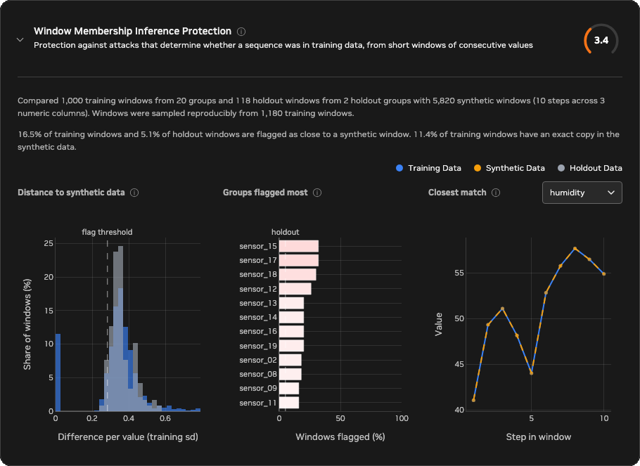

<!-- SPDX-FileCopyrightText: Copyright (c) 2025-2026 NVIDIA CORPORATION & AFFILIATES. All rights reserved. -->
<!-- SPDX-License-Identifier: Apache-2.0 -->

# Window Membership Inference Protection

Window Membership Inference Protection checks whether the synthetic data gives
away which sequences were used for training. A generator that memorizes its
training data reproduces stretches of the training sequences, so the synthetic
data sits closer to those sequences than to similar sequences the generator
never saw. This metric looks for that difference.

Two terms matter most:

- Membership inference: an attack in which someone who holds a real sequence,
  such as one sensor's readings or one patient's measurements, tries to tell
  whether it was in the training data. A generator protects its training data
  when the synthetic data doesn't help the attacker.
- Memorization: reproducing training data instead of learning the process
  behind it. A synthetic sensor that replays an hour of a real sensor's
  readings, exactly or with a little noise added, has memorized that hour.

The metric works on windows: short stretches of consecutive values, 10 steps
by default, across all evaluated numeric columns at once. It compares windows
from the training data and from the holdout data, the groups that Safe
Synthesizer set aside before training, with their nearest synthetic window.
This guide says "the attack" for that comparison and "the score" for the 0–10
metric.

The existing [Membership Inference
Protection](../../product-overview/evaluation.md#membership-inference-protection)
metric attacks single records. This metric attacks stretches of a sequence, so
it can find a copied trajectory even when no single row stands out.

The figure below shows one training group against three synthetic datasets
generated from the same training data. The right column shows what the attack
compares: how close each training window (blue) and each holdout window (gray)
comes to its nearest synthetic window. Windows to the left of the dashed line
are flagged as suspiciously close.


- Synthetic A is new data from the same process as the training data. Its
  windows are about as close to training windows as to holdout windows, so the
  two histograms overlap and it scores 10.0.
- Synthetic B is new data with 20% of its points pasted from training in short
  stretches, shaded in the plot. The pasted windows match training windows
  exactly, so a spike of training windows sits at distance 0 and it scores 2.4.
- Synthetic C is the training data with a little noise added. No window is an
  exact copy, but every training window has a close synthetic twin that holdout
  windows don't have, so it scores 0.6.

## Reading the score

A higher score means stronger protection: training windows are no easier to
find in the synthetic data than holdout windows. Differences small enough to be
explained by chance don't lower the score, so synthetic data generated by the
same process as the training data scores near 10. Synthetic data that copies
training sequences, in whole or in part, scores lower the more it copies, and
an exact copy scores about 0.5. Exact copies count in full: windows of
continuous data almost never match exactly by chance, so the chance correction
never removes them, and a small holdout can't hide them.

The score is relative to the holdout data. It asks whether the synthetic data
favors the training groups over unseen groups from the same source, not whether
it resembles real data in general. Synthetic data that matches the training
process closely can still score 10, and synthetic data of poor quality, even a
constant series, also scores highly as long as it copies nothing. Read this
score alongside the Synthetic Quality Score and the time-series fidelity
metrics, which measure quality.

The score needs grouped data and a holdout of whole groups. Safe Synthesizer
creates one when `data.group_training_examples_by` is set and `data.holdout` is
above 0. Without a group column, without holdout data, or with fewer than 20
training or holdout windows, the score is unavailable and the report shows copy
diagnostics only: the share of training windows with an exact copy in the
synthetic data, and the closest training and synthetic windows.

A high score means this attack found no sign of memorization. It is not a
guarantee: other attacks might still learn something about the training data,
as the Limitations section describes.

### Example scenarios

The figures below show how the metric scores a range of synthetic datasets,
ordered from the highest average score to the lowest. Each dataset has 10
training, 10 holdout, and 10 synthetic groups of 200 points with two numeric
columns. Each row shows:

- The first column of one training group (blue) and the matching synthetic
  group (orange). Where the synthetic data copies the training data, the lines
  lie on top of each other.
- The distance from every training window (blue) and holdout window (gray) to
  its nearest synthetic window, as the typical difference per value in training
  standard deviations. The dashed line is the flag threshold.
- The average score across 200 random datasets from the same scenario.


With about 200 points per group and 10 holdout groups, scores fall into rough
tiers:

- About 8 to 10: nothing is copied, for example fresh groups from the same
  process or a different one (about 9.8), shuffled training rows (about 9.5),
  shorter or gappy fresh groups (about 9.6 to 9.8), or a constant series (about
  9.5).
- About 5 to 8: a small share of the training data is copied, for example 5% of
  points pasted from training in short stretches (about 5.5).
- About 2 to 5: a large share is copied or closely imitated, for example one
  whole group of 10 (about 3.5), 20% of points in short stretches (about 2.3),
  or a copy of every group with noise half the size of the data's own variation
  (about 2.1).
- About 0 to 2: the synthetic data reproduces the training data, exactly, with
  tiny noise, shifted by a few steps, or with values missing (about 0.5 to
  0.7). The score bottoms out near 0.5 rather than 0, because the flag
  threshold always lets through 5% of holdout windows.

A copy with noise as large as the data itself scores about 9.4. The noise
buries each training window so deeply that unrelated synthetic windows come
closer, and the attack can't tell which synthetic sequence came from which
training sequence. The synthetic data still carries some information about the
training data, so a high score means the attack failed, not that nothing was
learned.

Sequence length and holdout size affect copies that aren't exact. Exact copies
are caught at any length and holdout size: one copied group of 10 scores about
3.8 with 50 points per group, 3.5 with 200, and 3.4 with 1,000. A blurred copy
has to stand out from chance instead. Longer sequences give more windows, which
helps, and fewer holdout groups give a noisier reference, which hurts. The
default `data.holdout` of 5% holds out only one or two groups from a dataset of
20 to 40 groups. Average scores still hold up, but a single run can land a few
points away from its average, and the report notes when only one holdout group
was available. Copies of most of the training data score near 0 at any length
or holdout size.

These tiers are a guide rather than pass or fail thresholds. Within one report,
every window uses the same columns, groups, and `window_size`. When you compare
scores across runs, check that those settings, the holdout, and the input
data's columns and groups are the same, because changing them changes what the
score measures. How much copying is acceptable depends on the use case. For
example, data shared outside an organization may need no detectable copying at
all, while data used only for internal testing may tolerate a small amount.

If the score is lower than your use case allows:

- Check the exact-copy rate above the charts and the Closest match chart. Exact
  copies mean the generator reproduced training sequences. Train for less time
  by lowering `training.num_input_records_to_sample`, add more training groups,
  or remove sequences that repeat in the training data. Differential privacy is
  not available in time-series mode.
- Check the Groups flagged most chart. A few groups far above the others point
  to sequences that are rare, short, or repeated in the training data, which are
  the easiest to memorize.
- If the score is unavailable, set `data.group_training_examples_by` and keep
  `data.holdout` above 0. If the note says the holdout has too few windows,
  raise `data.holdout` so that more groups are held out.

### Reading the report charts

The Window Membership Inference Protection card is in the automatically
generated HTML quality and privacy report. Select Data Privacy in the report's
navigation and find the card in the Protection Metrics panel, right after
Membership Inference Protection, then expand it to see three charts. Select the
info icon next to a chart title for a short reminder of how to read it. The
card appears in time-series mode, and its score does not yet count toward the
Data Privacy Score.



The example above comes from a dataset of 20 training sensors and 2 holdout
sensors, grouped by sensor ID, with three numeric columns of 300 hourly points.
Each synthetic sensor is new data from the same process, except that a share of
its points is pasted from the same training sensor in 20-step stretches. The
share rises gradually from none for `sensor_00` to 27% for `sensor_19`.

Above the charts, the card summarizes what was compared: 1,000 training windows
from 20 groups, sampled from 1,180, and 118 holdout windows from 2 holdout
groups, against 5,820 synthetic windows of 10 steps across 3 numeric columns. It
then gives the result of the attack: 16.5% of training windows and 5.1% of
holdout windows are flagged, and 11.4% of training windows have an exact copy in
the synthetic data. You can confirm each of the details below in the report
itself: hover over any bar to see its exact values, and use the column selector
on Closest match.

- Distance to synthetic data
  - What it shows: how close each training window (blue) and holdout window
    (gray) comes to its nearest synthetic window, as the typical difference per
    value in training standard deviations. Windows left of the dashed flag
    threshold are flagged. In well-protected synthetic data the blue and gray
    bars overlap. Blue bars piled up near 0, or blue bars shifted left of the
    gray ones, mean training windows have close copies in the synthetic data.
  - In this example: a spike of blue bars sits at 0, the 11.4% of training
    windows that were copied exactly. The rest of the blue bars overlap the gray
    ones around 0.3 to 0.5, so the windows that weren't copied are no closer to
    the synthetic data than holdout windows are.
- Groups flagged most
  - What it shows: the share of each training group's windows that are
    flagged, for up to 12 groups, most-flagged first. Chance alone flags about
    as many windows as the dashed holdout line. Bars shade from white at that
    line to red when every window of a group is flagged, and the axis always
    spans 0 to 100% so small excesses look small. Hover over a bar to see its
    full group name, window count, and share of exact copies.
  - In this example: `sensor_15` and `sensor_17` have the most flagged windows,
    32% each, followed by `sensor_18` at 30%. These are among the sensors with
    the most pasted stretches; `sensor_15` has 24% exact copies. Some groups
    with no copies are also flagged above the holdout line, such as `sensor_02`
    at 18% with no exact copies. With only two holdout groups, the holdout line
    is a rough reference, so look for groups that stand clearly above the
    others and for exact copies.
- Closest match
  - What it shows: the training window that comes closest to any synthetic
    window (blue), and that synthetic window (orange, dashed), for one numeric
    column at a time. Use the column selector next to the title to switch
    columns. Lines that lie on top of each other mean the synthetic data
    contains a copy of this stretch of training data. Lines that only follow a
    similar shape are what new data from the same process looks like.
  - In this example: the closest training window is from `sensor_12`, and the
    synthetic data contains an exact copy of it, so the two lines coincide in
    every column. The chart opens on `humidity`, the first column in
    alphabetical order.

## Configuration

Time-series evaluation runs by default whenever `time_series.is_timeseries` is
true. It computes the metric and adds its card to the Protection Metrics panel
in the Data Privacy section of the HTML evaluation report. Set
`evaluation.time_series.enabled: false` to skip all time-series metrics.
Setting it to `true` without time-series mode is a configuration error.

```yaml
data:
  group_training_examples_by: sensor_id
  holdout: 0.05
time_series:
  is_timeseries: true
  timestamp_column: timestamp
evaluation:
  time_series:
    enabled: null  # null follows time_series.is_timeseries
    window_group_mia:
      value_columns: null
      window_size: 10
      max_windows: 1000
      max_columns: 12
```

Values are ordered by `time_series.timestamp_column` and split into sequences by
`data.group_training_examples_by`. The holdout is the set of groups that
`data.holdout` sets aside before training; raise it to hold out more groups and
make the score less noisy.

`value_columns: null` combines every column that both datasets share and that
is inferred as numeric, up to `max_columns`. If there are more, the metric uses
a reproducible random sample of `max_columns` columns. Set an explicit list to
evaluate selected numeric columns; an explicit list is always used in full.

`window_size` sets how many consecutive values make up one window, and windows
start every half window. Shorter windows give more windows per group, so
partial copies show up in shorter sequences, but they can miss copies that are
blurred by noise. Longer windows catch blurred copies better but need longer
sequences.

`max_windows` caps the training and holdout windows compared, each, to bound
runtime. When there are more, the metric takes a reproducible sample balanced
across groups and reports the total and evaluated counts. Fewer windows make the
score noisier. The synthetic data contributes every window, starting at every
step, up to 50,000.

## Limitations

The metric runs one attack: it compares windows by their distance to the
nearest synthetic window. It can't rule out other attacks. A copy blurred by
noise as large as the data scores about 9.4 even though each synthetic value
still correlates about 0.7 with the training value it came from. Copies that
were transformed, such as rescaled, shifted in level, or run backward, also
look unrelated to this attack, as do copied stretches shorter than
`window_size`.

The score depends on the holdout. The holdout groups must come from the same
source as the training groups. If they differ, for example sensors from a
different site, the metric partly corrects for the difference, but the score
becomes less reliable. With one or two holdout groups, a single run varies
noticeably. Short sequences give few windows, so a partial copy that isn't
exact can look like chance. The lowest possible score is about 0.5, not 0.

The metric uses numeric columns only. Categorical and free-text columns are not
compared, so a generator that copies text or category sequences is not caught.
Row-level [Membership Inference
Protection](../../product-overview/evaluation.md#membership-inference-protection)
covers single records, and the time-series fidelity metrics, such as
[Autocorrelation Similarity](autocorrelation-similarity.md) and
[Rolling Stats Similarity](rolling-stats-similarity.md), cover quality. The
score does not yet count toward the Data Privacy Score.

The score summarizes all windows, columns, and groups in one number, so it
can't tell you about a particular group or stretch of time. To judge whether
the synthetic data protects the sequences your use case depends on, look at the
detailed report charts, especially Groups flagged most and Closest match, for
the groups that matter to you.

## Calculation

The metric first fills gaps in each numeric column of each group by linear
interpolation, holding the first and last observed values beyond the ends. It
then cuts every group into windows of \(w\) consecutive values (`window_size`),
flattened across the \(c\) evaluated columns into \(D = w \cdot c\) values, and
never crosses group boundaries. Training and holdout windows start every
\(s = \lfloor w/2 \rfloor\) steps and are capped at `max_windows` each, with a
reproducible sample shuffled within each group and taken round robin across
groups. Synthetic windows start at every step, so a copy shifted off the
training grid is still found, and are capped at 50,000. Every window value is
standardized by the mean and standard deviation of the sampled training windows.

For every training and holdout window, the metric finds its nearest synthetic
window by Euclidean distance \(d\). The report charts show \(d / \sqrt{D}\), the
typical difference per value. The flag threshold \(\tau\) is the 5% quantile of
the holdout distances, so about 5% of holdout windows are flagged by
construction. With \(k_T\) of \(n_T\) training windows and \(k_H\) of \(n_H\)
holdout windows at or below \(\tau\), the privacy loss is the log ratio of the
two flag rates, with half a window added to each count so it stays finite:

\[
L = \ln \frac{k_T + \tfrac{1}{2}}{n_T + 1} - \ln \frac{k_H + \tfrac{1}{2}}{n_H + 1}
\]

If the synthetic data favors no group, both rates are about 5% and \(L\) is
near 0. If every training window is flagged, \(L\) is about \(\ln 20 \approx
3\).

Two sources of chance make \(L\) positive even without memorization, and the
metric estimates both:

1. Binomial noise. The flag counts are random, so \(L\) varies by
   \[
   \sigma_B^2 = \frac{w}{s} \left( \frac{1}{k_T + \tfrac{1}{2}} - \frac{1}{n_T + 1} + \frac{1}{k_H + \tfrac{1}{2}} - \frac{1}{n_H + 1} \right),
   \]
   the usual variance of a log ratio of two rates, multiplied by \(w / s\)
   because windows that start every half window share points, so their flags
   are correlated.
2. Holdout offset. The holdout groups can sit closer to or farther from the
   synthetic data than the training groups for reasons unrelated to copying,
   which the binomial noise misses and which matters most with one or two
   holdout groups. The metric splits the training groups in half six times,
   with a fixed seed. One half plays the training data and the other half the
   synthetic data, and the attack runs against the real holdout. Nothing is
   copied in these splits, so the average of \(L^2 - \sigma_B^2\) across them,
   floored at 0, measures the holdout's own offset, \(\sigma_O^2\). The
   synthetic data never enters this estimate, so copying can't inflate it.

The expected chance contribution is removed before taking the square root, as
in the other time-series metrics:

\[
L' = \sqrt{\max\left(0,\ L^2 - \sigma_B^2 - \sigma_O^2\right)} \text{ when } L > 0, \text{ otherwise } L' = 0
\]

Exact copies are the exception. Windows of continuous data almost never match
a synthetic window exactly by chance, so a small holdout must not be able to
explain them away. With \(x\) the share of training windows at distance 0,
minus the share of holdout windows at distance 0 (which covers data with
repeated stretches, such as a sensor stuck at one value), and
\(\alpha = (k_H + \tfrac{1}{2}) / (n_H + 1)\) the holdout flag rate, the loss
from exact copies alone is

\[
L_{\text{exact}} = \ln\left(1 + x \, \frac{1 - \alpha}{\alpha}\right),
\]

the privacy loss if those windows were certainly flagged and the rest were
flagged at the holdout rate. The score uses whichever loss is larger:

\[
\text{score} = 10 \cdot e^{-\max(L',\ L_{\text{exact}})}
\]

So 10 means the training flag rate is within chance of the holdout flag rate,
and each unit of privacy loss beyond chance divides the score by \(e\). When
every training window is flagged, the score is about \(10 \times 5\% = 0.5\).
