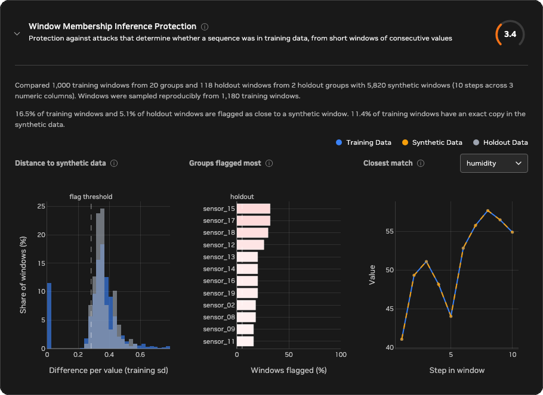

<!-- SPDX-FileCopyrightText: Copyright (c) 2025-2026 NVIDIA CORPORATION & AFFILIATES. All rights reserved. -->
<!-- SPDX-License-Identifier: Apache-2.0 -->

# Window Membership Inference Protection

Window Membership Inference Protection is the time-series counterpart of
[Membership Inference
Protection](../../product-overview/evaluation.md#membership-inference-protection).
Both ask whether an attacker who holds a real record and the synthetic data can
tell if that record was used for training.
Membership Inference Protection attacks single rows. This metric attacks
windows, which are short stretches of consecutive values (10 steps by default)
taken from one group, such as one sensor or one patient, as set by
`data.group_training_examples_by`. It compares windows from the training groups
with windows from the holdout groups, which Safe Synthesizer set aside before
training, and checks whether training windows sit closer to the synthetic data.
If they do, the generator memorized stretches of its training sequences, even
when no single row stands out.

An exact copy of the training data is therefore the worst case.
Every training window has a twin in the synthetic data and no holdout window
does, so an attacker can tell members from non-members perfectly.

The figure below shows one training group against three synthetic datasets.
The right column shows how close each training window (blue) and each holdout
window (gray) comes to its nearest synthetic window.
Windows left of the dashed line are flagged as suspiciously close.


- Synthetic A is new data from the same process. Training and holdout windows
  are equally close to it, so the histograms overlap and it scores 10.0.
- Synthetic B is new data with 20% of its points pasted from training, shaded
  in the plot. The pasted windows sit at distance 0, so it scores 2.4.
- Synthetic C is the training data with a little noise added. No window is an
  exact copy, but every training window has a close twin that holdout windows
  lack, so it scores 0.6.

## Reading the score

The score runs from 0 to 10, and higher means stronger protection. A score near
10 means training windows are no closer to the synthetic data than holdout
windows, after allowing for chance. The more of the training data the synthetic
data copies, the lower the score. A full copy scores about 0.5, the lowest
possible score, because the flag threshold always flags 5% of holdout windows.

Exact copies always lower the score. Continuous values almost never repeat
exactly by chance, so the metric never discounts an exact copy as noise, even
when the holdout is small.

With about 200 points per group and 10 holdout groups, scores fall into rough
tiers, taken from the [example scenarios](#example-scenarios):

- About 8 to 10 means nothing is copied, as with fresh groups (about 9.8),
  shuffled training rows (about 9.5), or a constant series (about 9.5).
- About 5 to 8 means a small share is copied, as with 5% of points pasted from
  training (about 5.5).
- About 2 to 5 means a large share is copied or closely imitated, as with one
  whole group out of 10 (about 3.5), 20% of points (about 2.3), or every group
  with noise of half a standard deviation (about 2.1).
- About 0 to 2 means the synthetic data reproduces the training data, exactly,
  with tiny noise, shifted by a few steps, or with values missing (about 0.5 to
  0.7).

Use these tiers as a guide. How much copying is acceptable depends on the use
case. Data shared outside an organization may need no detectable copying, while
data used only for internal testing may tolerate some.

The score measures copying only. Poor synthetic data, even a constant series,
scores high as long as it copies nothing. Read it alongside the
Synthetic Quality Score and the time-series fidelity metrics. Compare scores
across runs only when the columns, groups, holdout, and `window_size` are the
same.

### Reading the report charts

The card is in the Protection Metrics panel of the Data Privacy section of the
HTML evaluation report, right after Membership Inference Protection. Expand it
to see the charts, and select the info icon next to a chart title for a short
reminder of how to read it. The score is reported on its own and is not part of
the Data Privacy Score.



This example has 20 training sensors and 2 holdout sensors, each with three
numeric columns of 300 hourly points. Each synthetic sensor is new data, except
that a share of its points is pasted from the matching training sensor in
20-step stretches. The share rises from none for `sensor_00` to 27% for
`sensor_19`.

The summary above the charts says what was compared and what the attack found.
Here, 16.5% of training windows and 5.1% of holdout windows are flagged, and
11.4% of training windows have an exact copy in the synthetic data.

- Distance to synthetic data
  - This chart shows how close each training window (blue) and holdout window
    (gray) comes to its nearest synthetic window, as the typical difference per
    value in training standard deviations. Windows left of the dashed line are
    flagged. In well-protected data the blue and gray bars overlap. Blue bars
    piled up at 0, or shifted left of the gray ones, mean training windows have
    close copies.
  - In this example, a spike of blue bars at 0 is the 11.4% of training windows
    copied exactly. The remaining blue bars overlap the gray ones, so the
    windows that weren't copied are no closer than holdout windows.
- Groups flagged most
  - This chart shows the share of each training group's windows that are
    flagged, for up to 12 groups, most-flagged first. The dashed line is the
    holdout flag rate, which is what chance alone produces. Bars turn redder
    the further they rise above it. Hover over a bar to see the group's share
    of exact copies.
  - In this example, `sensor_15` and `sensor_17` lead at 32% each, and
    `sensor_15` has 24% exact copies. Both are among the sensors with the most
    pasted stretches. Some uncopied sensors, such as `sensor_02` at 18%, also
    sit above the line. With only two holdout groups the line is a rough
    reference, so look for groups that stand clearly above the rest.
- Closest match
  - This chart shows the synthetic window (orange, dashed) closest to any
    training window, one numeric column at a time. If it is an exact copy, the
    training window (blue) is drawn on top of it. Otherwise the training window
    stays hidden, so the report never shows training values that the synthetic
    data doesn't already contain.
  - In this example, the closest match is an exact copy of a `sensor_12`
    window, so the two lines coincide in every column.

### When the score is available

The score needs:

- Grouped data, set by `data.group_training_examples_by`.
- Groups at least `window_size` points long.
- At least 20 training windows and 20 holdout windows.
- At least two holdout groups. A single holdout group can happen to sit close
  to the synthetic data, which hides a blurred copy and can make it score a
  perfect 10.

When these aren't met, the card skips the score. It still shows the share of
training windows with an exact copy in the synthetic data and the Closest match
chart.

## Example scenarios

The figures below score a range of synthetic datasets, ordered from the highest
average score to the lowest. Each dataset has 10 training, 10 holdout, and 10
synthetic groups of 200 points with two numeric columns, a 24-step cycle and a
slowly wandering series. Copied stretches are 40 steps long, and noise is
measured in training standard deviations. Each row shows one training group
(blue) with its synthetic counterpart (orange), the distance histograms, and the
average score across 200 random datasets.


Exact copies score about the same regardless of sequence length or holdout
size. Blurred copies are judged against chance, so a smaller holdout makes them
harder to see. A copy with noise of half a standard deviation averages about
2.1 with 10 holdout groups and 2.7 with 2, and single runs vary more.

## Configuration

Time-series evaluation runs by default whenever `time_series.is_timeseries` is
true. Set `evaluation.time_series.enabled: false` to skip all time-series
metrics.

```yaml
data:
  group_training_examples_by: sensor_id
  holdout: 0.05
time_series:
  is_timeseries: true
  timestamp_column: timestamp
evaluation:
  time_series:
    enabled: null  # null follows time_series.is_timeseries
    window_group_mia:
      value_columns: null
      window_size: 10
      max_windows: 1000
      max_columns: 12
```

Values are ordered by `time_series.timestamp_column` and split into sequences by
`data.group_training_examples_by`.

- Leave `value_columns` as `null` to combine the numeric training columns, up
  to a reproducible sample of `max_columns`. Set an explicit list to check
  selected columns, such as one sensitive column on its own.
- Lower `window_size` to find partial copies in short sequences, or raise it to
  find copies blurred by noise.
- Lower `max_windows` to bound runtime, at the cost of a noisier score.

## Limitations

- The metric runs one attack on numeric columns only. Transformed copies
  (rescaled, shifted in level, or run backward), copied stretches shorter than
  `window_size`, and copied categorical or text sequences are not caught.
- Heavy noise hides copies. A copy blurred by noise as large as the data scores
  about 9.4, even though each synthetic value still correlates about 0.7 with
  the training value it came from.
- Partial-column copies are mostly missed, because the uncopied columns dominate
  the distance. With one column copied exactly from every group, the score
  averaged 6.8 with 2 columns, 9.2 with 6, and 9.6 with 12. Set `value_columns`
  to a sensitive column to check it on its own.
- The holdout must come from the same source as the training data. With every
  holdout value shifted by 1.5 standard deviations, fresh synthetic data
  averaged 7.0, down from 9.8, and single runs went as low as 1.1.

## Calculation

The metric first fills gaps in each numeric column of each group by linear
interpolation, holding the first and last observed values beyond the ends. It
then cuts every group into windows of \(w\) consecutive values (`window_size`),
flattened across the \(c\) evaluated columns into \(D = w \cdot c\) values, and
never crosses group boundaries. Training and holdout windows start every
\(s = \lfloor w/2 \rfloor\) steps and are capped at `max_windows` each, with a
reproducible sample shuffled within each group and taken round robin across
groups. Synthetic windows start at every step, so a copy shifted off the
training grid is still found, and are capped at 50,000. Every window value is
standardized by the mean and standard deviation of the sampled training windows.

For every training and holdout window, the metric finds its nearest synthetic
window by Euclidean distance \(d\). The report charts show \(d / \sqrt{D}\), the
typical difference per value. The flag threshold \(\tau\) is the 5% quantile of
the holdout distances, so about 5% of holdout windows are flagged by
construction. With \(k_T\) of \(n_T\) training windows and \(k_H\) of \(n_H\)
holdout windows at or below \(\tau\), the privacy loss is the log ratio of the
two flag rates, with half a window added to each count so it stays finite:

\[
L = \ln \frac{k_T + \tfrac{1}{2}}{n_T + 1} - \ln \frac{k_H + \tfrac{1}{2}}{n_H + 1}
\]

If the synthetic data favors no group, both rates are about 5% and \(L\) is
near 0. If every training window is flagged, \(L\) is about \(\ln 20 \approx
3\).

Two sources of chance make \(L\) positive even without memorization, and the
metric estimates both:

1. Binomial noise. The flag counts are random, so \(L\) varies by
   \[
   \sigma_B^2 = \frac{w}{s} \left( \frac{1}{k_T + \tfrac{1}{2}} - \frac{1}{n_T + 1} + \frac{1}{k_H + \tfrac{1}{2}} - \frac{1}{n_H + 1} \right),
   \]
   the usual variance of a log ratio of two rates, multiplied by \(w / s\)
   because windows that start every half window share points, so their flags
   are correlated.
2. Holdout offset. The holdout groups can sit closer to or farther from the
   synthetic data than the training groups for reasons unrelated to copying,
   which the binomial noise misses and which matters most with one or two
   holdout groups. The metric splits the training groups in half six times,
   with a fixed seed. One half plays the training data and the other half the
   synthetic data, and the attack runs against the real holdout. Nothing is
   copied in these splits, so the average of \(L^2 - \sigma_B^2\) across them,
   floored at 0, measures the holdout's own offset, \(\sigma_O^2\). The
   synthetic data never enters this estimate, so copying can't inflate it.

The expected chance contribution is removed before taking the square root, as
in the other time-series metrics:

\[
L' = \sqrt{\max\left(0,\ L^2 - \sigma_B^2 - \sigma_O^2\right)} \text{ when } L > 0, \text{ otherwise } L' = 0
\]

Exact copies are the exception, because chance almost never explains them.
With \(x\) the share of training windows at distance 0,
minus the share of holdout windows at distance 0 (which covers data with
repeated stretches, such as a sensor stuck at one value), and
\(\alpha = (k_H + \tfrac{1}{2}) / (n_H + 1)\) the holdout flag rate, the loss
from exact copies alone is

\[
L_{\text{exact}} = \ln\left(1 + x \, \frac{1 - \alpha}{\alpha}\right),
\]

the privacy loss if those windows were certainly flagged and the rest were
flagged at the holdout rate. The score uses whichever loss is larger:

\[
\text{score} = 10 \cdot e^{-\max(L',\ L_{\text{exact}})}
\]

Before the chance correction, the score is 10 times the holdout flag rate
divided by the training flag rate, capped at 10. So 10 means the training flag
rate is within chance of the holdout flag rate, and each unit of privacy loss
beyond chance divides the score by \(e\). When every training window is
flagged, the score is about \(10 \times 5\% = 0.5\).
